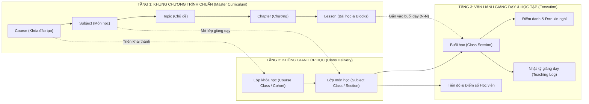

# 02. ĐẶC TẢ YÊU CẦU SẢN PHẨM & NGHIỆP VỤ (PRODUCT REQUIREMENTS DOCUMENT — PRD)
> **Dự án:** Phân hệ E-Learning tích hợp LMSPLUS
> **Tài liệu liên quan:** [`01-current-system-audit.md`](./01-current-system-audit.md), [`03-sitemap-user-flows.md`](./03-sitemap-user-flows.md)

---

## 1. Tầm nhìn Sản phẩm & Định hướng Trải nghiệm

Phân hệ **E-Learning** mở rộng nền tảng quản lý đào tạo **LMSPLUS** từ một hệ thống quản trị giáo vụ truyền thống thành một không gian dạy và học số hóa toàn diện, kết hợp tinh hoa của 3 nền tảng hàng đầu thế giới trên nền tảng thẩm mỹ **Airbnb DLS + Impeccable**:

1. **Trải nghiệm Học tập từ Coursera:**
   - Điều hướng tuần tự mạch lạc, nút **"Tiếp tục học" (Resume Learning)** thông minh đưa học viên trở lại đúng giây video hoặc vị trí đoạn văn đang đọc dở.
   - Không gian học bài (Lesson Player) tập trung cao độ, tích hợp phụ đề tương tác, ghi chú gắn mốc thời gian (Timestamped Notes), câu hỏi kiểm tra nhanh và điều kiện mở khóa rõ ràng.
2. **Trải nghiệm Soạn thảo Nội dung từ Notion:**
   - Giảng viên xây dựng bài giảng bằng **Block Editor** linh hoạt (Văn bản, Callout sư phạm, Công thức LaTeX, Ví dụ giải từng bước, Quiz tương tác, Multimedia, Code Sandbox) với cơ chế lưu trữ JSON có `schema_version`, hỗ trợ tái sử dụng **Shared Blocks** và quản lý phiên bản (**Draft / Published / Revision History**).
3. **Năng lực Quản trị Học thuật từ Moodle / Canvas LMS:**
   - Quản trị chặt chẽ mối quan hệ giữa **Khung chương trình chuẩn (Curriculum)** và **Lớp triển khai thực tế (Class Delivery)**, kết nối đồng bộ Thời khóa biểu, Điểm danh đa phương thức (QR xoay vòng, Zoom/Meet), Đơn xin nghỉ, Học bù, Nhật ký giảng dạy và Sổ điểm.

---

## 2. Mô hình Khái niệm Cốt lõi (Core Domain Model)

Để tránh nhầm lẫn nghiệp vụ khi thiết kế UI/UX và Database, hệ thống phân định rõ **3 tầng thực thể học thuật**:

### Phân biệt rõ hai khái niệm Lớp học trên Giao diện & Dữ liệu:
1. **Lớp khóa học (`Course Class` / Cohort — ví dụ: *K18 Kỹ thuật Phần mềm - Đợt 1/2026*):**
   - Là không gian tổng hợp của toàn bộ khóa đào tạo.
   - Hiển thị lộ trình tổng thể các môn học trong khóa, tiến độ hoàn thành toàn khóa (`CourseProgress`), thông báo chung của khóa và bảng tổng hợp kết quả các môn.
2. **Lớp môn học (`Subject Class` / Section — ví dụ: *Cấu trúc Dữ liệu & Giải thuật - Lớp CS102.01*):**
   - Là đơn vị vận hành giảng dạy thực tế của từng môn học, có Giảng viên phụ trách, Trợ giảng, Thời khóa biểu riêng, Danh sách buổi học (`ClassSession`), Điểm danh, Bài tập, Kiểm tra, Diễn đàn môn học và Nhật ký giảng dạy.

---

## 3. Yêu cầu Chức năng theo Không gian Sử dụng (Functional Requirements)

### A. Không gian Học viên (`Learning Portal` — 12 Màn hình)

| Mã | Màn hình | Yêu cầu Nghiệp vụ Chi tiết |
| :---: | :--- | :--- |
| **LP-01** | **Trang chủ học tập** | - Hiển thị lời chào cá nhân hóa và chuỗi ngày học tập. - Khối **"Tiếp tục học" (Hero Resume Card)** nổi bật nhất: hiển thị tên môn/khóa, bài học đang học dở, phần trăm hoàn thành, thời lượng còn lại và nút CTA dẫn thẳng vào đúng vị trí bài học (`lesson_id` + `last_position_sec` / `last_block_id`). - Danh sách **Khóa học của tôi**, **Tiến độ học tập**, **Lịch học sắp tới** (kèm nút vào phòng Zoom/Meet hoặc quét QR điểm danh), **Bài tập cần hoàn thành** (sắp xếp theo deadline gần nhất), **Kiểm tra sắp diễn ra**, **Hoạt động mới từ giảng viên** và **Thông báo**. |
| **LP-02** | **Khám phá khóa học** | - Tìm kiếm theo từ khóa, lọc theo môn học, chương trình đào tạo và trạng thái đăng ký. - **Mô hình cấu hình phương thức tham gia kết hợp (`enrollment_policy` riêng cho từng khóa học):**   1. `ASSIGNED_ONLY` *(Mặc định)*: Khóa học thuộc chương trình đào tạo chính thức, do Giáo vụ phân lớp; chỉ hiển thị cho học viên thuộc diện được phân công.   2. `REQUEST_APPROVAL`: Khóa học kỹ năng chung, tự chọn hoặc mở rộng; học viên được xem, bấm **"Gửi yêu cầu tham gia"** và chờ người có thẩm quyền phê duyệt.   3. `SELF_ENROLL`: Không bật mặc định; chỉ kích hoạt khi Quản trị viên (`ADMIN`) chủ động cấu hình cho phép học viên tự ghi danh. - Giữ nguyên cơ chế phân lớp và phân quyền hiện tại của LMSPLUS. |
| **LP-03** | **Khóa học của tôi** | - Quản lý các khóa học và lớp môn học đang tham gia (`Đang học`, `Đã hoàn thành`, `Sắp mở`). - Cho phép chuyển đổi góc nhìn theo **Lớp khóa học (Cohort)** hoặc theo từng **Lớp môn học (Subject Class)**. |
| **LP-04** | **Chi tiết khóa học** | - Hiển thị thông tin tổng quan: Tên, mô tả, giảng viên, mục tiêu học tập (`Learning Outcomes`), tiến độ hoàn thành. - Tab phân tách rõ: Danh sách môn học (nếu ở cấp Lớp khóa học), Chương trình học (Topic → Chapter → Lesson), Thời gian/Lịch học, Bài tập, Kiểm tra, và Thảo luận. |
| **LP-05** | **Không gian học bài** *(Trọng tâm)* | - Bố cục 3 vùng chuẩn Coursera: **Sidebar trái** (cây Chương/Bài học + trạng thái hoàn thành/khóa), **Khu vực trung tâm** (Video Player HLS hoặc Nội dung bài đọc Block Renderer + thanh điều hướng Bài trước/Bài tiếp), **Khu vực phụ/Tab dưới hoặc Drawer phải** (Tài liệu đính kèm, Ghi chú cá nhân theo mốc thời gian, Câu hỏi nhanh, Thảo luận gắn bài học, Thuật ngữ Wiki). - Tự động lưu tiến độ xem video (mỗi 10–15s qua cơ chế idempotent heartbeat) và vị trí cuộn bài đọc. - Hiển thị rõ điều kiện mở khóa bài học (`LessonUnlockConditions`) và tiến độ chương. |
| **LP-06** | **Wiki thuật ngữ** | - Tra cứu từ điển thuật ngữ chuyên ngành theo môn học, chữ cái hoặc từ đồng nghĩa (`WikiAliases`). - Khi đang đọc bài giảng ở màn `LP-05`, các thuật ngữ được gắn link (`LessonTermLinks`) sẽ hiển thị định nghĩa nhanh qua Popover mà không làm học viên rời khỏi bài học. |
| **LP-07** | **Diễn đàn học tập** | - Hỗ trợ 4 loại chủ đề: `Hỏi đáp (Q&A)`, `Thảo luận (Discussion)`, `Thảo luận có chấm điểm (Graded Discussion)`, `Thông báo (Announcement)`. - Hỗ trợ trả lời lồng tối đa 2 cấp (`Topic` → `Reply cấp 1` → `Reply cấp 2`), gắn thẻ bài học, `@mention`, thả cảm xúc (`Reaction`), theo dõi (`Subscribe`) và báo cáo vi phạm (`Report`). |
| **LP-08** | **Bài tập** | - Xem danh sách bài tập gắn chương trình và bài tập ngoài chương trình. - Xem đề bài, rubric tiêu chí chấm, thời hạn (`Due Date`), số lần nộp cho phép/còn lại, tải tệp bài làm hoặc nhập nội dung, xem lịch sử các lần nộp (`Submission History`) cùng điểm số và nhận xét chi tiết của giảng viên. |
| **LP-09** | **Kiểm tra** | - Danh sách bài kiểm tra định kỳ hoặc kiểm tra cuối chương. - Màn hình phòng thi trực tuyến có đồng hồ đếm ngược thời gian thực, tự động lưu câu trả lời tạm thời, hiển thị quy tắc tính điểm (`Cao nhất`, `Lần cuối`, `Trung bình`) và kết quả sau khi nộp. |
| **LP-10** | **Tiến độ học tập** | - Thống kê chi tiết tỷ lệ hoàn thành bài học, chương, khóa học, thời lượng học tập, điểm bài tập và điểm kiểm tra theo từng môn. |
| **LP-11** | **Lịch học** | - Lịch học theo Tuần/Tháng/Danh sách kết hợp cả buổi học trực tiếp/trực tuyến (`ClassSession`), lịch học bù (`MakeUpSession`), hạn nộp bài tập và lịch thi. - Tích hợp thao tác **Điểm danh QR** và **Gửi đơn xin nghỉ phép (`LeaveRequest`)** kèm minh chứng. |
| **LP-12** | **Thông báo** | - Trung tâm thông báo phân loại theo `Học tập`, `Bài tập & Kiểm tra`, `Diễn đàn`, `Điểm danh & Lịch học`, hỗ trợ đánh dấu đã đọc và điều hướng sâu (Deep-link) tới đúng đối tượng. |

---

### B. Không gian Giảng viên (`Teaching Workspace` — 16 Màn hình)

| Mã | Màn hình | Yêu cầu Nghiệp vụ Chi tiết |
| :---: | :--- | :--- |
| **TW-01** | **Dashboard giảng dạy** | - Tổng quan lịch dạy hôm nay/tuần này, danh sách **Buổi dạy cần xác nhận nhật ký** (cảnh báo nổi bật nếu quá hạn), số lượng bài tập chờ chấm, đơn xin nghỉ chờ duyệt, câu hỏi mới từ học viên và cảnh báo học viên có nguy cơ chậm tiến độ. |
| **TW-02** | **Quản lý khóa học** | - Xem và quản lý các khóa học được phân công làm chủ nhiệm hoặc biên soạn nội dung. |
| **TW-03** | **Quản lý lớp môn học** | - Quản lý không gian vận hành của từng lớp môn học (`SubjectClass`): danh sách học viên, phân công quyền cho Trợ giảng, lịch trình buổi học, cấu hình điều kiện mở khóa bài học riêng cho lớp nếu cần. |
| **TW-04** | **Quản lý cấu trúc chương trình** | - Xây dựng cây cấu trúc `Topic` → `Chapter` → `Lesson` bằng thao tác kéo-thả, thiết lập điều kiện tiên quyết (`LessonPrerequisites`), quy tắc hoàn thành (`CompletionRules`) và gắn bài học vào các buổi học dự kiến (`LessonSessions`). |
| **TW-05** | **Trình soạn bài giảng (Notion-style Block Editor)** | - Trình soạn thảo khối chuyên nghiệp (Text, Callout sư phạm, LaTeX, Bảng, Ví dụ giải từng bước, Quiz tương tác, Multimedia, Code Sandbox). - Hỗ trợ kéo thả sắp xếp block, nhúng `SharedBlocks`, chế độ Xem thử (`Preview`), Tự động lưu nháp (`Autosave`) có kiểm soát xung đột, Xuất bản phiên bản mới (`Publish LessonVersion`) và Khôi phục lịch sử chỉnh sửa. |
| **TW-06** | **Quản lý học liệu** | - Thư viện quản lý tập trung Video, Slide PDF, Audio, Sơ đồ, Bộ dữ liệu thực hành và **Shared Blocks** dùng chung giữa nhiều bài học. |
| **TW-07** | **Wiki thuật ngữ (Giảng viên)** | - Tạo, biên tập, phân loại và phê duyệt thuật ngữ chuyên ngành (`Draft` → `Published`), quản lý tên gọi đồng nghĩa (`Aliases`), định nghĩa theo ngữ cảnh môn học và quan hệ giữa các thuật ngữ. |
| **TW-08** | **Giao bài tập** | - Tạo bài tập gắn với bài học/chương học hoặc bài tập độc lập cho một hay nhiều lớp môn học; cấu hình hạn nộp, nộp muộn, số lần nộp tối đa và thang điểm. |
| **TW-09** | **Chấm bài** | - Giao diện chấm bài tập trung (SpeedGrader style): xem trực tiếp file/nội dung bài nộp của từng lần nộp, nhập điểm, viết nhận xét, đính kèm file sửa bài, trả bài hoặc yêu cầu học viên nộp lại; hỗ trợ chấm điểm cả chủ đề thảo luận (`Graded Forum`). |
| **TW-10** | **Quản lý kiểm tra** | - Kết nối với ngân hàng câu hỏi và module `Assessment` của LMSPLUS để gắn đề kiểm tra vào chương trình học, cấu hình thời gian mở/đóng đề, thời lượng làm bài, số lần làm và quy tắc lấy điểm. |
| **TW-11** | **Diễn đàn môn học** | - Quản lý thảo luận theo phạm vi từng lớp hoặc dùng chung toàn môn; hỗ trợ ghim (`Pin`), khóa (`Lock`), đánh dấu câu trả lời chuẩn của giảng viên (`Endorsed Answer`), xử lý báo cáo vi phạm (`Moderation`) và chấm điểm thảo luận. |
| **TW-12** | **Điểm danh** | - Điểm danh thủ công trên danh sách lớp (`Có mặt`, `Đi muộn`, `Về sớm`, `Vắng có phép`, `Vắng không phép`, `Học bù`). - Bật màn hình chiếu **Mã QR động** thay đổi tự động mỗi 15–30 giây. - Đồng bộ dữ liệu tham gia từ Zoom / Google Meet. - Mọi chỉnh sửa điểm danh sau buổi học đều bắt buộc ghi lý do vào `AttendanceAuditLogs`. |
| **TW-13** | **Quản lý đơn xin nghỉ** | - Tiếp nhận, xem minh chứng (`AttendanceEvidence`), phê duyệt hoặc từ chối đơn xin nghỉ của học viên; tự động cập nhật trạng thái điểm danh thành `Vắng có phép` và gợi ý xếp lịch **Học bù (`MakeUpSessions`)**. |
| **TW-14** | **Nhật ký giảng dạy** | - Ghi nhận thực tế triển khai của từng buổi học (`TeachingLogs`): giờ bắt đầu/kết thúc thực tế, giảng viên đứng lớp (chính thức hoặc dạy thay), trợ giảng tham gia, danh sách bài học đã dạy xong (`COMPLETED`) hoặc mới dạy một phần (`PARTIAL`), ghi chú bàn giao cho buổi sau. |
| **TW-15** | **Xác nhận buổi dạy** | - Quy trình chốt và ký xác nhận hoàn thành buổi dạy của giảng viên (tách biệt hoàn toàn với bảng điểm danh học viên):   1. Giảng viên có **24 giờ** sau thời điểm kết thúc buổi học để xác nhận nhật ký giảng dạy.   2. Sau 24 giờ chưa xác nhận, hệ thống tự động chuyển trạng thái sang `OVERDUE_UNCONFIRMED`.   3. **Quá hạn không khóa quyền xác nhận:** Giảng viên vẫn có thể xác nhận muộn (hệ thống đánh dấu xác nhận muộn, lưu thời điểm kết thúc buổi học, thời điểm xác nhận thực tế và lịch sử chuyển trạng thái trong `TeachingLogHistory`).   4. Giáo vụ và Quản trị viên có bảng theo dõi riêng để nhắc nhở và xử lý các buổi quá hạn. |
| **TW-16** | **Theo dõi tiến độ học viên** | - Bảng ma trận theo dõi tiến độ xem bài giảng, thời lượng học, tỷ lệ chuyên cần và kết quả bài tập/kiểm tra của từng học viên trong lớp; lọc nhanh nhóm học viên có nguy cơ rớt môn hoặc bỏ cuộc (`At-Risk Learners`). |

---

### C. Không gian Trợ giảng & Giáo vụ (`Teaching Assistant & Academic Affairs Workspace`)

- **Nguyên tắc Phân quyền Tối thiểu (`Least Privilege`):**
  - **Trợ giảng (`TA`):** Không mặc định có toàn quyền của Giảng viên. Quyền của TA được cấp phát tường minh theo từng `subject_class_id` thông qua cấu hình cờ quyền (`can_manage_materials`, `can_manage_assignments`, `can_grade`, `can_moderate_forum`, `can_take_attendance`). TA không được phép xóa khóa học, không được sửa cấu trúc chương trình gốc đã xuất bản nếu không được cấp quyền, và không được ký xác nhận giờ dạy chính thức của Giảng viên.
  - **Giáo vụ (`Academic Affairs`):** Có không gian giám sát tình trạng vận hành các lớp học thuộc khoa/trung tâm quản lý: theo dõi các buổi dạy quá hạn xác nhận nhật ký, quản lý lịch dạy thay/dạy bù, hỗ trợ duyệt đơn xin nghỉ, kiểm tra chuyên cần và tiến độ học tập toàn khóa.
