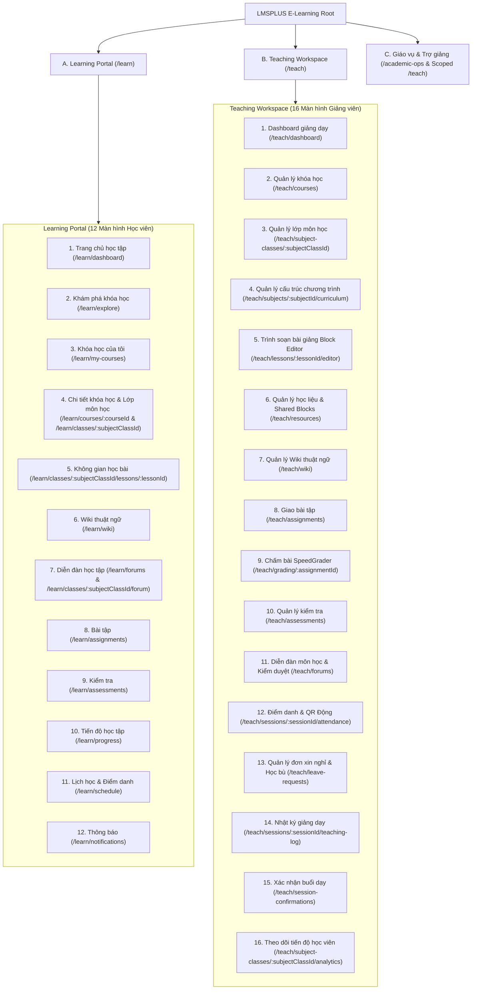
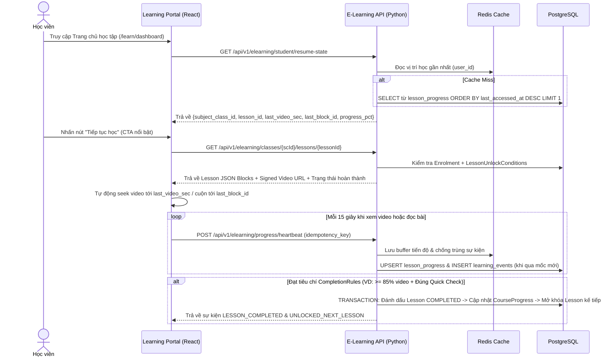
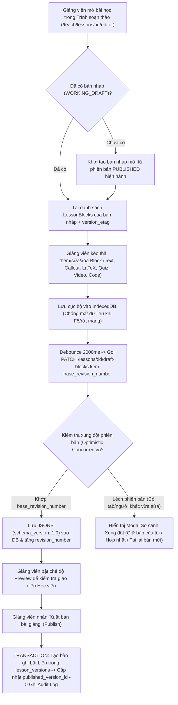
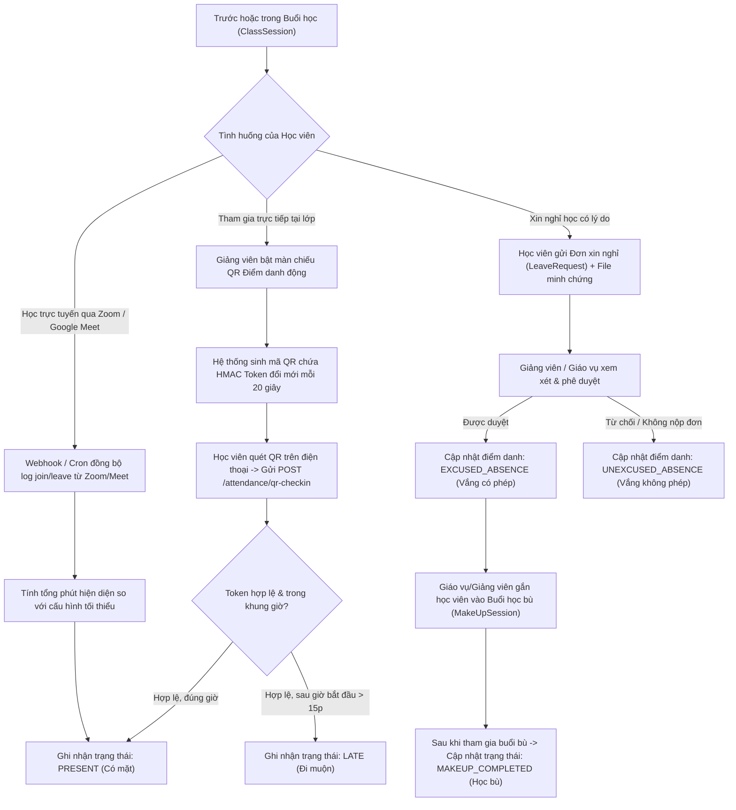
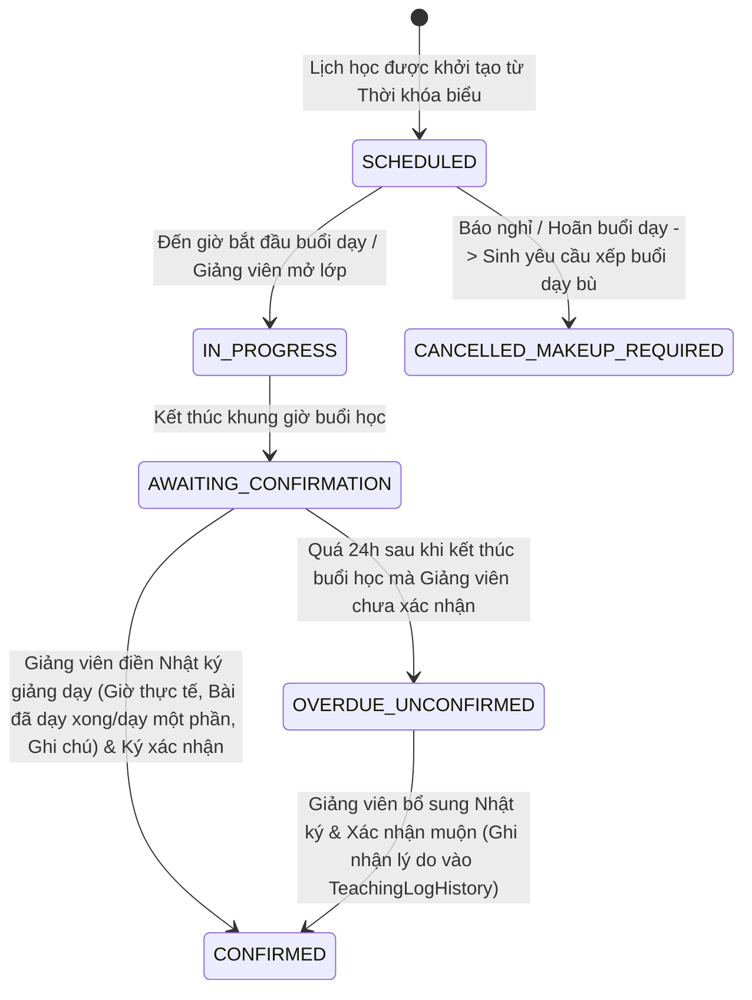

# 03. KIẾN TRÚC THÔNG TIN, SITEMAP & LUỒNG NGƯỜI DÙNG (SITEMAP & USER FLOWS)
> **Dự án:** Phân hệ E-Learning tích hợp LMSPLUS
> **Tài liệu liên quan:** [`02-product-requirements.md`](./02-product-requirements.md), [`05-ui-ux-specification.md`](./05-ui-ux-specification.md)

---

## 1. Sơ đồ Kiến trúc Thông tin Tổng thể (Master Sitemap)

Hệ thống định tuyến (React Router) được tổ chức thành 3 phân khu không gian làm việc rõ ràng, tích hợp vào App Shell của LMSPLUS:

- `/learn/*` — **Learning Portal** (Không gian Học viên)
- `/teach/*` — **Teaching Workspace** (Không gian Giảng viên & Trợ giảng theo quyền được cấp)
- `/academic-ops/*` — **Academic Affairs Workspace** (Không gian Giáo vụ giám sát & hỗ trợ đào tạo)

---

## 2. Bảng Định tuyến Chi tiết (React Route Specification)

| Phân khu | Mã màn | Tên màn hình | Đường dẫn React Router (`path`) | Layout sử dụng | Quyền truy cập (`Scope Guard`) |
| :--- | :---: | :--- | :--- | :--- | :--- |
| **Learning** | LP-01 | Trang chủ học tập | `/learn/dashboard` | `PortalAppShell` | `STUDENT` |
| **Learning** | LP-02 | Khám phá khóa học | `/learn/explore` | `PortalAppShell` | `STUDENT` (Lọc theo `enrollment_policy`) |
| **Learning** | LP-03 | Khóa học của tôi | `/learn/my-courses` | `PortalAppShell` | `STUDENT` |
| **Learning** | LP-04A | Chi tiết Lớp khóa học | `/learn/course-classes/:courseClassId` | `PortalAppShell` | `EnrolledStudentGuard` |
| **Learning** | LP-04B | Chi tiết Lớp môn học | `/learn/subject-classes/:subjectClassId` | `PortalAppShell` | `EnrolledStudentGuard` |
| **Learning** | LP-05 | **Không gian học bài** | `/learn/subject-classes/:subjectClassId/lessons/:lessonId` | `FocusPlayerLayout` | `EnrolledStudentGuard` + `LessonUnlockGuard` |
| **Learning** | LP-06 | Wiki thuật ngữ | `/learn/wiki` | `PortalAppShell` | `STUDENT`, `INSTRUCTOR`, `TA` |
| **Learning** | LP-07 | Diễn đàn học tập | `/learn/forums/:forumId` | `PortalAppShell` | `ForumScopeGuard` |
| **Learning** | LP-08 | Bài tập của tôi | `/learn/assignments` | `PortalAppShell` | `STUDENT` |
| **Learning** | LP-09 | Bài kiểm tra | `/learn/assessments` | `PortalAppShell` | `STUDENT` |
| **Learning** | LP-10 | Tiến độ học tập | `/learn/progress` | `PortalAppShell` | `STUDENT` |
| **Learning** | LP-11 | Lịch học & Xin nghỉ | `/learn/schedule` | `PortalAppShell` | `STUDENT` |
| **Learning** | LP-12 | Thông báo | `/learn/notifications` | `PortalAppShell` | `AuthenticatedGuard` |
| **Teaching** | TW-01 | Dashboard giảng dạy | `/teach/dashboard` | `WorkspaceAppShell` | `INSTRUCTOR`, `TA`, `ACADEMIC_STAFF` |
| **Teaching** | TW-02 | Quản lý khóa học | `/teach/courses` | `WorkspaceAppShell` | `INSTRUCTOR`, `ACADEMIC_STAFF`, `ADMIN` |
| **Teaching** | TW-03 | Quản lý lớp môn học | `/teach/subject-classes/:subjectClassId` | `WorkspaceAppShell` | `AssignedClassStaffGuard` |
| **Teaching** | TW-04 | Cấu trúc chương trình | `/teach/subjects/:subjectId/curriculum` | `WorkspaceAppShell` | `SubjectAuthorGuard` |
| **Teaching** | TW-05 | **Trình soạn bài giảng** | `/teach/lessons/:lessonId/editor` | `EditorFullLayout` | `LessonAuthorGuard` |
| **Teaching** | TW-06 | Quản lý học liệu | `/teach/resources` | `WorkspaceAppShell` | `INSTRUCTOR`, `TA (can_manage_materials)` |
| **Teaching** | TW-07 | Quản lý Wiki | `/teach/wiki` | `WorkspaceAppShell` | `INSTRUCTOR`, `TA (can_manage_materials)` |
| **Teaching** | TW-08 | Giao bài tập | `/teach/assignments` | `WorkspaceAppShell` | `INSTRUCTOR`, `TA (can_manage_assignments)` |
| **Teaching** | TW-09 | Chấm bài tập | `/teach/assignments/:assignmentId/grading` | `GraderSplitLayout` | `INSTRUCTOR`, `TA (can_grade)` |
| **Teaching** | TW-10 | Quản lý kiểm tra | `/teach/assessments` | `WorkspaceAppShell` | `INSTRUCTOR`, `ACADEMIC_STAFF` |
| **Teaching** | TW-11 | Diễn đàn môn học | `/teach/forums` | `WorkspaceAppShell` | `INSTRUCTOR`, `TA (can_moderate_forum)` |
| **Teaching** | TW-12 | Điểm danh lớp học | `/teach/sessions/:sessionId/attendance` | `WorkspaceAppShell` | `INSTRUCTOR`, `TA (can_take_attendance)` |
| **Teaching** | TW-13 | Quản lý đơn xin nghỉ | `/teach/leave-requests` | `WorkspaceAppShell` | `INSTRUCTOR`, `ACADEMIC_STAFF`, `TA` |
| **Teaching** | TW-14 | Nhật ký giảng dạy | `/teach/sessions/:sessionId/teaching-log` | `WorkspaceAppShell` | `INSTRUCTOR`, `TA (view/draft)` |
| **Teaching** | TW-15 | Xác nhận buổi dạy | `/teach/session-confirmations` | `WorkspaceAppShell` | `INSTRUCTOR` (Ký xác nhận), `ACADEMIC_STAFF` (Giám sát) |
| **Teaching** | TW-16 | Tiến độ học viên | `/teach/subject-classes/:subjectClassId/progress` | `WorkspaceAppShell` | `AssignedClassStaffGuard` |

---

## 3. Các Luồng Người Dùng Trọng Tâm (Core End-to-End User Flows)

### 3.1. Luồng 1: Học viên "Tiếp tục học" & Ghi nhận Tiến độ Bài học (`Resume & Unlock Flow`)

---

### 3.2. Luồng 2: Giảng viên Soạn bài giảng với Notion-Style Block Editor (`Draft → Autosave → Publish`)

---

### 3.3. Luồng 3: Điểm danh Đa phương thức, Đơn xin nghỉ & Học bù (`Attendance & Leave Flow`)

---

### 3.4. Luồng 4: Nhật ký Giảng dạy & Xác nhận Buổi dạy (`Teaching Log & Confirmation Flow`)

> **Nguyên tắc nghiệp vụ quan trọng:** Tình trạng điểm danh của học viên (`AttendanceRecords`) và việc ghi nhận giờ dạy thực tế của giảng viên (`TeachingLogs`) là **hai luồng dữ liệu độc lập** nhưng cùng gắn với một `ClassSession`.

