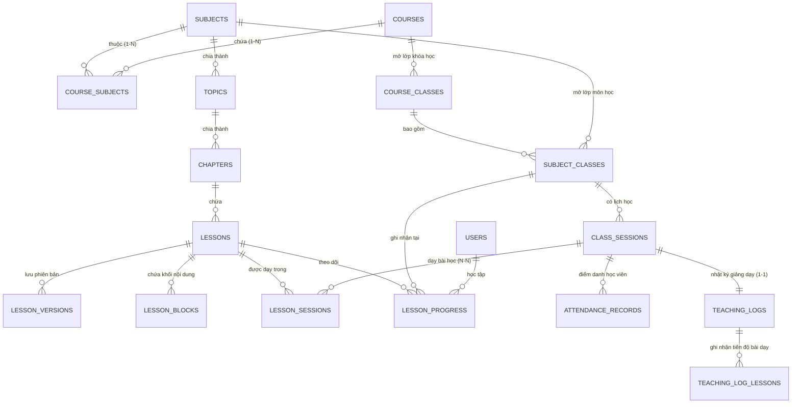
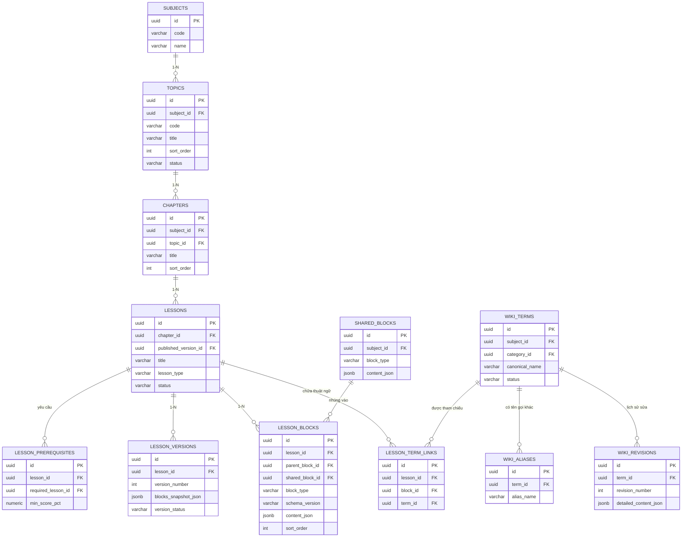
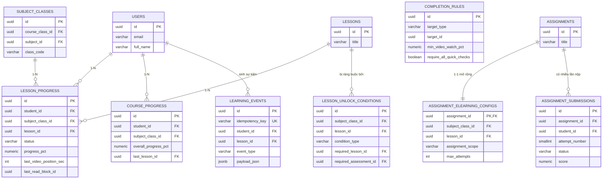
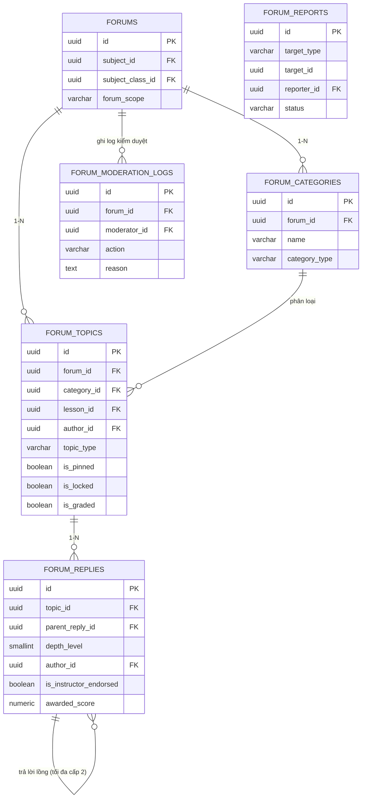
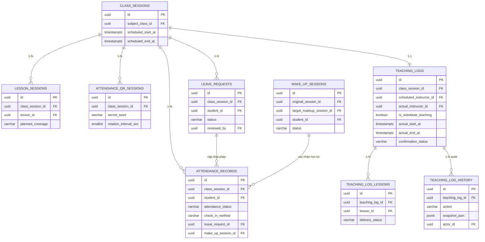

# 07. SƠ ĐỒ QUAN HỆ THỰC THỂ (ENTITY-RELATIONSHIP DIAGRAMS — ERD)
> **Dự án:** Phân hệ E-Learning tích hợp LMSPLUS
> **Tài liệu liên quan:** [`06-database-design.md`](./06-database-design.md)

---

## 1. Sơ đồ ERD Tổng thể Liên Phân hệ (Master Overview ERD)

Sơ đồ dưới đây thể hiện mối quan hệ giữa các bảng lõi hiện có của **LMSPLUS** (`users`, `courses`, `subjects`, `course_classes`, `subject_classes`, `class_sessions`, `assignments`, `assessments`) và hệ sinh thái bảng mở rộng của **E-Learning**:

---

## 2. ERD Chi tiết từng Domain Nghiệp vụ

### 2.1. Domain 1 & 2: Cấu trúc Chương trình, Block Editor & Wiki Thuật ngữ

---

### 2.2. Domain 4 & 5: Tiến độ Học tập, Điều kiện Mở khóa, Bài tập & Kiểm tra

---

### 2.3. Domain 6: Diễn đàn Học thuật (`Academic Forums`)

---

### 2.4. Domain 7 & 8: Điểm danh, Đơn xin nghỉ, Học bù & Nhật ký Giảng dạy

