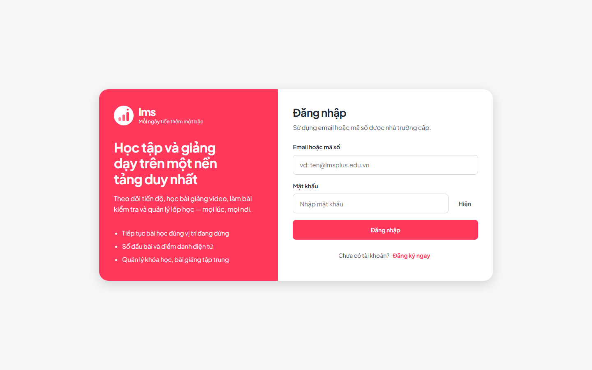
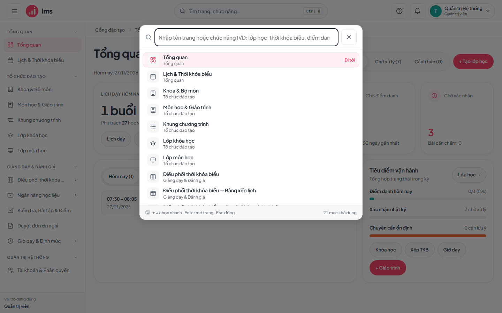
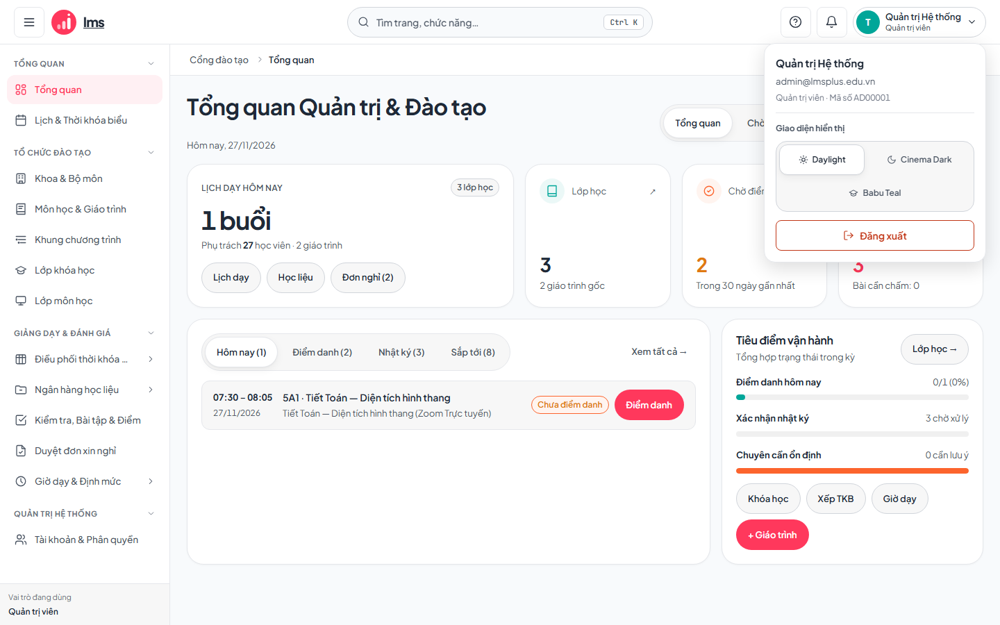

# Chương 01: Đăng nhập, Khung điều hướng chung & Tiện ích Hệ thống

Tài liệu này hướng dẫn thao tác đăng nhập, đăng ký tài khoản học viên và sử dụng thanh điều hướng dùng chung trên toàn bộ hệ thống LMSPLUS.

---

## 1. Đăng nhập & Tạo tài khoản Học viên

Khi chưa đăng nhập, mọi đường dẫn đều hiển thị màn hình **Đăng nhập**:

### Các bước đăng nhập
1. Nhập **Email hoặc mã số** (ví dụ `thuha.gv@lmsplus.edu.vn` hoặc `HS50101`).
2. Nhập **Mật khẩu** (có thể bấm nút **Hiện** / **Ẩn** để kiểm tra ký tự).
3. Bấm **Đăng nhập**. Hệ thống tự động điều hướng theo vai trò:
   - Tài khoản chỉ có vai trò Học viên → `/learn` (**Không gian học tập**).
   - Các vai trò Giảng viên / Trợ giảng / Trưởng bộ môn / Giáo vụ / Quản trị viên → `/teaching` (**Tổng quan**).

> **Ghi chú:** Trên môi trường phát triển/staging, cột phải có danh sách tài khoản trải nghiệm nhanh; trên môi trường Production thực tế, danh sách này tự động ẩn để đảm bảo an toàn.

### Tự đăng ký tài khoản Học viên
1. Tại màn hình Đăng nhập, bấm liên kết chuyển sang chế độ **Tạo tài khoản học viên**.
2. Điền **Họ và tên**, **Email**, **Mã học viên** (tùy chọn) và **Mật khẩu** (tối thiểu 6 ký tự) + xác nhận mật khẩu.
3. Sau khi tạo xong, hệ thống cấp quyền **Học viên** mặc định và đăng nhập ngay vào cổng `/learn`.

---

## 2. Thanh Header cố định (Global Top Header)

Thanh Header nằm cố định ở trên cùng (`sticky`), gồm 3 khu vực:
- **Bên trái:** Nút **Đóng mở thanh điều hướng** (biểu tượng menu 3 gạch) và **Logo LMSPLUS** (bấm để quay về trang chủ `/teaching` hoặc `/learn`).
- **Ở giữa:** Thanh **Tìm kiếm nhanh (`Ctrl + K`)**.
- **Bên phải:** Nút **Trung tâm hỗ trợ (?)**, biểu tượng **Thông báo (chuông)** kèm huy hiệu số tin chưa đọc, và **Menu Hồ sơ người dùng**.

---

## 3. Tìm kiếm nhanh toàn hệ thống (`Ctrl + K`)

1. Nhấn tổ hợp phím **`Ctrl + K`** (hoặc `Cmd + K` trên macOS) hoặc bấm vào ô **Tìm trang, chức năng...** ở giữa Header.
2. Gõ từ khóa không dấu hoặc có dấu (ví dụ: `diem danh`, `zoom`, `khung chuong trinh`, `hoc lieu`).
3. Dùng phím mũi tên **`↑` `↓`** để di chuyển và **`Enter`** để đi thẳng tới trang chức năng tương ứng; nhấn **`Esc`** để đóng.
4. Kết quả tìm kiếm luôn lọc đồng bộ theo đúng quyền RBAC của tài khoản đang đăng nhập.

---

## 4. Thanh điều hướng trái (Sidebar) & Breadcrumb

- **Mở rộng (`245px`) / Thu gọn (`68px`):** Bấm nút menu bên trái Header để thu gọn Sidebar giúp tăng diện tích làm việc trên màn hình nhỏ. Khi thu gọn, rê chuột vào từng icon để xem tên chức năng qua tooltip. Trên màn hình di động (`≤ 900px`), Sidebar mở dạng ngăn kéo (drawer).
- **Tổ chức menu theo 4 nhóm rõ ràng (đối với Cổng Giảng dạy & Đào tạo):**
  - **Tổng quan:** *Tổng quan*, *Lịch & Thời khóa biểu*
  - **Tổ chức đào tạo:** *Khoa & Bộ môn*, *Môn học & Giáo trình*, *Khung chương trình*, *Lớp khóa học*, *Lớp môn học*
  - **Giảng dạy & Đánh giá:** *Điều phối thời khóa biểu*, *Ngân hàng học liệu*, *Kiểm tra, Bài tập & Điểm*, *Duyệt đơn xin nghỉ*, *Giờ dạy & Định mức*
  - **Quản trị hệ thống:** *Tài khoản & Phân quyền*
- **Breadcrumb phân cấp:** Luôn hiển thị ngay dưới Header giúp nhận biết vị trí trang hiện tại (ví dụ: `Cổng đào tạo > Lớp môn học > Lớp 5A1 > Lịch học > Phòng học trực tuyến`) và quay nhanh về các cấp trước chỉ bằng một cú nhấp.

---

## 5. Menu Hồ sơ, Đổi giao diện (Theme) & Trung tâm hỗ trợ

1. Bấm vào tên tài khoản ở góc trên bên phải để mở **Menu người dùng**, hiển thị đầy đủ Họ tên, Email, danh sách vai trò RBAC và Mã số nhân sự/học viên.
2. Trong mục **Giao diện hiển thị**, có thể chuyển đổi tức thì giữa 3 bộ giao diện chuẩn:
   - **Daylight (`airbnb-light`):** Nền sáng tinh gọn mặc định, phù hợp làm việc ban ngày.
   - **Cinema Dark (`cinema-dark`):** Nền tối dịu mắt cho học tập/làm việc ban đêm hoặc khi xem video bài giảng.
   - **Babu Teal (`babu-academy`):** Tông xanh ngọc học thuật nhẹ nhàng.
3. Bấm nút **Đăng xuất** để kết thúc phiên làm việc (hệ thống thu hồi JWT trên máy chủ ngay lập tức).
4. Bấm nút **(?)** bên cạnh chuông thông báo để mở **Trung tâm hỗ trợ LMSPLUS** xem bảng phím tắt, tóm tắt luồng nghiệp vụ 3 cấp và liên kết nhanh.

---

[← Quay lại Mục lục](./README.md) · [Tiếp theo: Chương 02 — Quản trị & Tổ chức Đào tạo →](./02-to-chuc-dao-tao.md)
