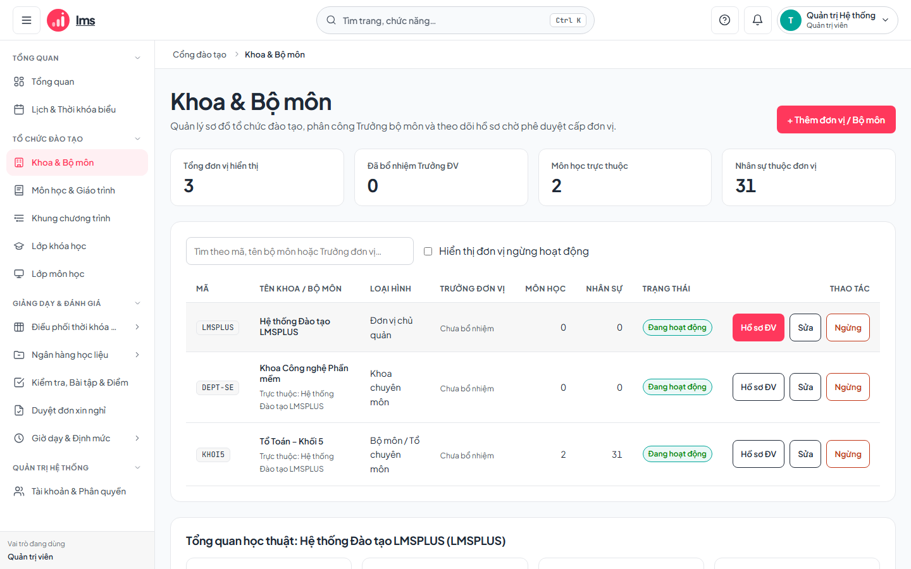
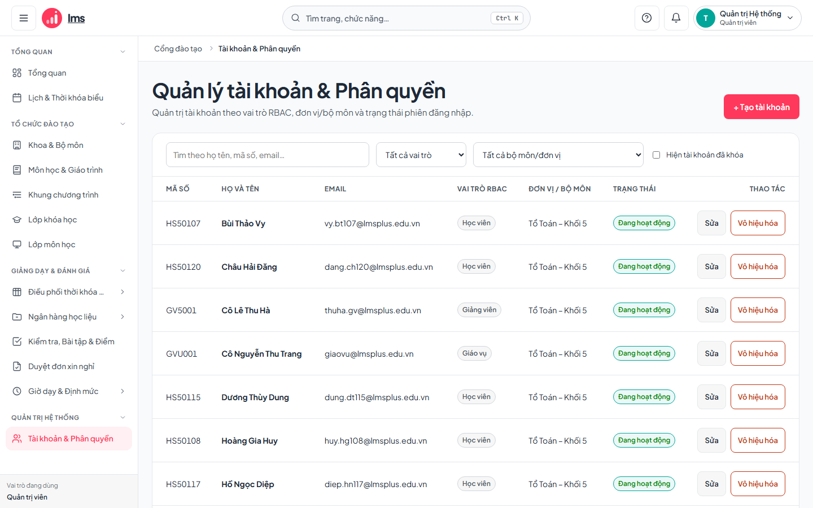
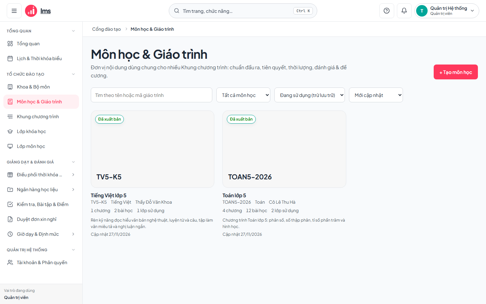
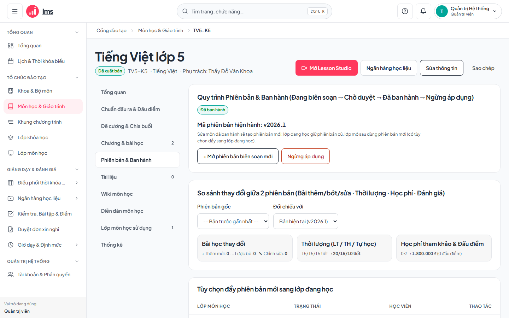
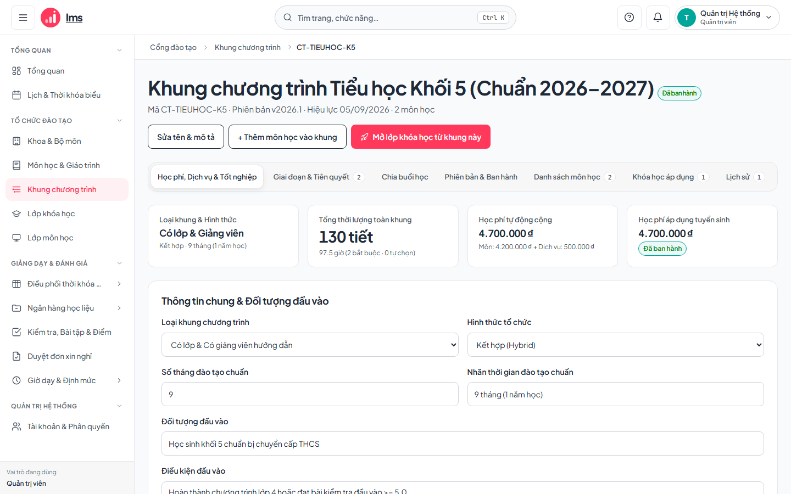
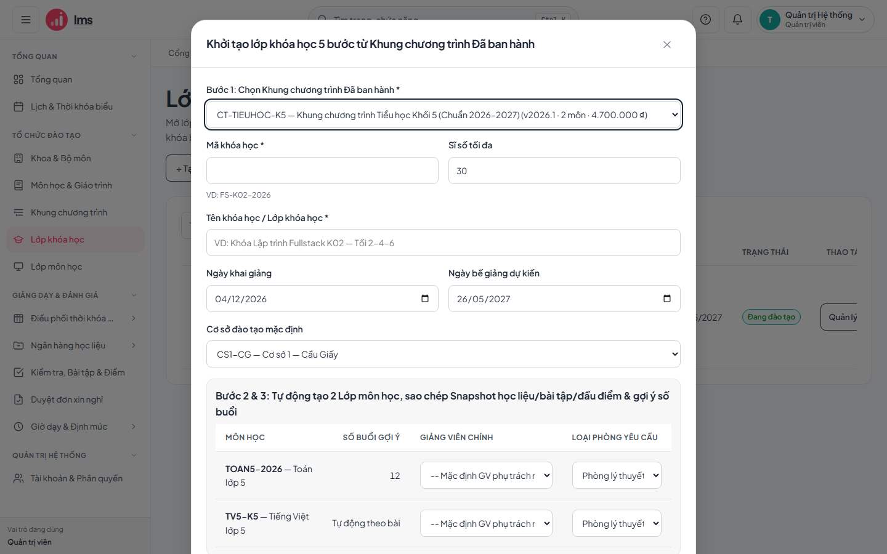
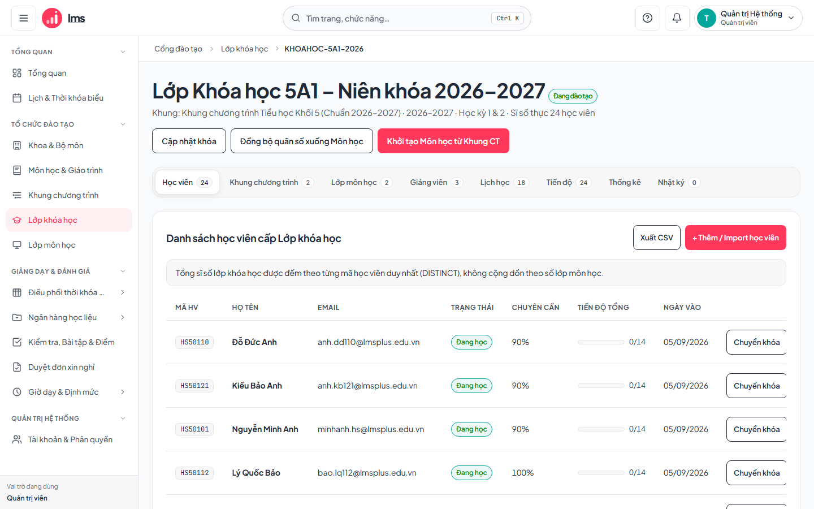

# Chương 02: Quản trị & Tổ chức Đào tạo

Chương này hướng dẫn các module thiết lập nền tảng tổ chức, nhân sự, giáo trình, khung chương trình và lớp khóa học (chủ yếu dành cho **Quản trị viên**, **Giáo vụ** và **Trưởng bộ môn**).

---

## 1. Khoa & Bộ môn (`/admin/departments`)

Module quản lý sơ đồ đơn vị chuyên môn, phân công Trưởng đơn vị và theo dõi hồ sơ học thuật đang chờ phê duyệt.

### Thao tác chính
1. **Theo dõi chỉ số tổng hợp:** 4 thẻ KPI hiển thị tổng số đơn vị, số đơn vị đã bổ nhiệm Trưởng ĐV, số môn học trực thuộc và nhân sự thuộc đơn vị.
2. **Tìm kiếm & Lọc:** Nhập mã/tên bộ môn hoặc tên Trưởng đơn vị vào thanh tìm kiếm; bật tùy chọn *Hiển thị đơn vị ngừng hoạt động* để xem các đơn vị đã ẩn.
3. **Thêm / Sửa đơn vị:** Bấm **+ Thêm đơn vị / Bộ môn** (chỉ Quản trị viên), điền *Mã đơn vị*, *Tên Khoa / Bộ môn*, chọn *Loại hình* (`Đơn vị chủ quản`, `Khoa chuyên môn`, `Bộ môn / Tổ chuyên môn`, `Trung tâm đào tạo`), chọn đơn vị cha và bổ nhiệm *Trưởng đơn vị*.
4. **Phê duyệt học thuật cấp Bộ môn:** Nhấp vào tên một Khoa/Bộ môn trong bảng để xem bảng tổng hợp nhân sự, môn học và danh sách môn học / khung chương trình đang chờ duyệt ban hành ngay bên dưới.

---

## 2. Tài khoản & Phân quyền (`/admin/accounts`)

### Thao tác chính
1. **Lọc đa chiều:** Tìm nhanh theo *họ tên, mã số, email*; lọc theo *Vai trò RBAC* (`Học viên`, `Giảng viên`, `Trợ giảng`, `Trưởng bộ môn`, `Giáo vụ`, `Quản trị viên`, `Quản trị tối cao`) hoặc theo *Đơn vị / Bộ môn*.
2. **Tạo tài khoản mới:** Bấm **+ Tạo tài khoản**, nhập Họ tên, Email, Mã số (nếu để trống hệ thống tự cấp), chọn Vai trò RBAC, gán Đơn vị/Bộ môn và đặt Mật khẩu (tối thiểu 6 ký tự).
3. **Chỉnh sửa phân quyền / Khóa tài khoản:** Bấm **Sửa** để đổi vai trò hoặc đặt lại mật khẩu; hoặc bấm nút khóa/ngừng kích hoạt. Khi thay đổi vai trò hoặc khóa tài khoản, mọi JWT đang hoạt động của người dùng đó bị thu hồi ngay lập tức.

---

## 3. Môn học & Giáo trình (`/teaching/courses`)

Mỗi **Môn học (Course)** là giáo trình chuẩn có thể dùng chung cho nhiều **Lớp môn học** mà không trùng lặp dữ liệu.

1. Bấm **+ Tạo môn học** để khai báo môn mới: mã môn, tiêu đề, môn học, số tiết/phút quy đổi, mô tả và **Chế độ tham gia**:
   - `ASSIGNED_ONLY` *(mặc định)*: Học viên chỉ vào lớp khi được Giáo vụ / Quản trị phân công.
   - `REQUEST_APPROVAL`: Học viên gửi yêu cầu tham gia và chờ duyệt.
   - `SELF_ENROLL`: Học viên tự đăng ký vào học (chỉ bật khi Quản trị viên cho phép cho môn học cụ thể).
2. Nhấp vào thẻ môn học để mở trang **Chi tiết Môn học** với 10 tab chức năng:
   - *Tổng quan* · *Chuẩn đầu ra & Đầu điểm* · *Đề cương & Chia buổi* · *Chương & bài học* (cây 4 cấp kéo-thả Chủ đề → Chương → Bài học) · *Phiên bản & Ban hành* · *Tài liệu* · *Wiki môn học* · *Diễn đàn môn học* · *Lớp môn học sử dụng* · *Thống kê*.

3. **Ban hành Snapshot & So sánh Diff:** Tại tab *Phiên bản & Ban hành*, giảng viên gửi duyệt và Trưởng bộ môn / Quản trị viên bấm phê duyệt ban hành phiên bản (vd `v2026.1` → `v2026.2`) kèm bảng đối chiếu Diff giữa các phiên bản.

---

## 4. Khung chương trình (`/teaching/curricula`)

1. Từ danh sách Khung chương trình, bấm **+ Tạo khung chương trình mới** hoặc chọn khung có sẵn để vào chi tiết gồm 7 tab:
   - **Học phí, Dịch vụ & Tốt nghiệp:** Cấu hình học phí, phí dịch vụ và điều kiện tốt nghiệp.
   - **Giai đoạn & Tiên quyết:** Chia môn theo học kỳ/giai đoạn và kiểm tra cảnh báo ngược thứ tự môn tiên quyết.
   - **Chia buổi học:** Kế hoạch chia số buổi mặc định cho từng môn trong khung.
   - **Phiên bản & Ban hành:** Quản lý trạng thái *Bản nháp (`DRAFT`)* / *Đã ban hành (`PUBLISHED`)* / *Lưu trữ*. **Lưu ý:** Hệ thống chặn mở Lớp khóa học nếu Khung chương trình còn ở trạng thái Bản nháp.
   - **Danh sách môn học**, **Khóa học áp dụng** và **Lịch sử** chỉnh sửa.

---

## 5. Lớp khóa học & Wizard Khởi tạo 5 bước (`/teaching/cohorts`)

### Khởi tạo nhanh bằng Wizard 5 bước
1. Tại trang **Lớp khóa học**, bấm **Khởi tạo lớp khóa học (5 bước)**.
2. **Bước 1:** Chọn *Khung chương trình Đã ban hành*, nhập *Mã khóa học*, *Tên khóa học*, *Sĩ số tối đa*, ngày khai giảng/bế giảng dự kiến và *Cơ sở đào tạo mặc định*.
3. **Bước 2–3:** Xem trước danh sách **Lớp môn học** sẽ tự động tạo, chọn *Giảng viên chính* và *Loại phòng yêu cầu* cho từng môn (hệ thống tự sao chép Snapshot học liệu, bài tập hạn nộp tương đối và gợi ý số buổi).
4. **Bước 4–5:** Hoàn tất để hệ thống mở đồng loạt Khóa học và toàn bộ các Lớp môn học trực thuộc.

### Quản lý Chi tiết Lớp khóa học (`/teaching/cohorts/:cohortId`)

Trang chi tiết gồm 8 tab (*Học viên*, *Khung chương trình*, *Lớp môn học*, *Giảng viên*, *Lịch học*, *Tiến độ*, *Thống kê*, *Nhật ký*) và các nút hành động nhanh trên đầu trang:
- **+ Thêm / Import học viên** & **Xuất CSV**: Nhập danh sách học viên theo mã hoặc email ở cấp Khóa học; có thể **Chuyển khóa** hoặc **Rút khỏi khóa**.
- **Đồng bộ quân số xuống Môn học**: Đẩy toàn bộ danh sách học viên đang học xuống các Lớp môn học trực thuộc.
- **Khởi tạo Môn học từ Khung CT**: Sinh bổ sung lớp môn còn thiếu nếu khung chương trình vừa cập nhật.

---

[← Chương 01](./01-dang-nhap-va-giao-dien-chung.md) · [Mục lục](./README.md) · [Tiếp theo: Chương 03 — Lesson Studio & Ngân hàng Học liệu →](./03-lesson-studio-va-hoc-lieu.md)
