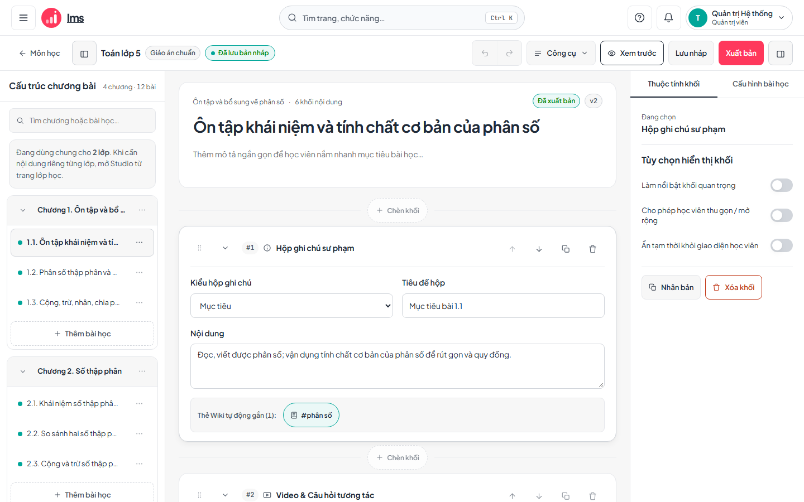
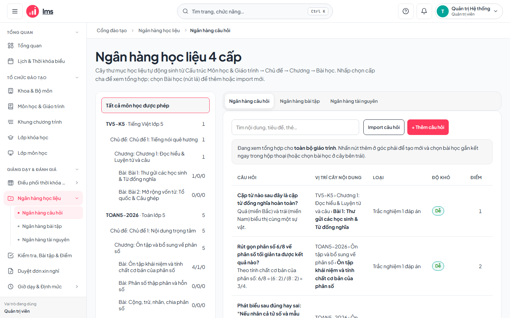
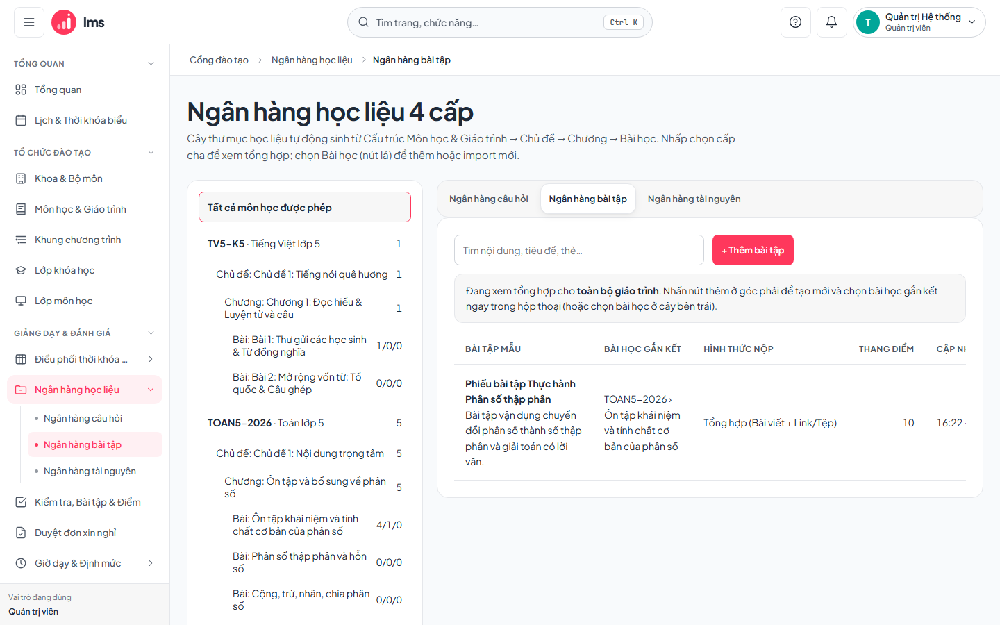

# Chương 03: Lesson Studio & Ngân hàng Học liệu

Chương này hướng dẫn biên soạn giáo án điện tử đa khối với **Lesson Studio** (cùng Video Quiz tương tác) và quản lý tài nguyên giảng dạy chuẩn hóa theo cây 4 cấp trong **Ngân hàng học liệu**.

---

## 1. Lesson Studio (`/teaching/courses/:courseId/studio` & `/teaching/classes/:classId/studio`)

Lesson Studio hỗ trợ 2 chế độ biên soạn rõ rệt:
- **Chế độ A — Giáo án chuẩn (Cấp Môn học):** Mở từ trang *Chi tiết Môn học*. Mọi thay đổi lưu bản nháp và **Xuất bản** thành phiên bản chuẩn cho khóa học.
- **Chế độ B — Tùy biến theo lớp (Cấp Lớp môn học):** Mở từ tab *Nội dung* của *Chi tiết Lớp môn học* để thêm ghi chú giảng viên hoặc tinh chỉnh nội dung riêng cho lớp mà không làm hỏng giáo trình gốc.

### Bố cục làm việc 3 vùng
1. **Thanh công cụ trên cùng:**
   - Trở về trang Môn học/Lớp, hiển thị chế độ (*Giáo án chuẩn*), trạng thái lưu nháp tự động, nút **Undo / Redo**, menu **Công cụ**, **Xem trước** (giả lập Desktop / Mobile), **Lưu nháp** và **Xuất bản**.
2. **Cột trái — Cấu trúc chương bài:**
   - Tìm nhanh chương/bài học, thêm mới chương hoặc bài học, sắp xếp thứ tự và xem cảnh báo số lớp đang dùng chung giáo trình.
3. **Vùng giữa — Canvas soạn thảo khối nội dung:**
   - Thêm nhanh khối bằng nút **+ Chèn khối** hoặc thanh **THÊM NHANH** ở cuối bài: *Đoạn văn bản*, *Video & Quiz*, *Hình ảnh*, *Tài liệu PDF*, *Bài kiểm tra*, *Hộp ghi chú sư phạm*, *Công thức / Mã nguồn*, *Lời giải từng bước*...
   - Mỗi khối hỗ trợ di chuyển lên/xuống (`↑` `↓`), nhân bản, xóa khối và tự động gắn liên kết thẻ Wiki (`#từ_khóa`) nếu khớp thuật ngữ trong Wiki môn học.
4. **Cột phải — Inspector (Thuộc tính khối & Cấu hình bài học):**
   - Tab **Thuộc tính khối:** Làm nổi bật khối quan trọng, cho phép học viên thu gọn/mở rộng hoặc ẩn tạm thời khỏi giao diện học viên.
   - Tab **Cấu hình bài học:** Đặt mô tả, mục tiêu, thời lượng (phút) và **Quy tắc hoàn thành bài học**:
     - Cho phép chọn yêu cầu hoàn thành video tối thiểu (`min_video_watch_pct`, vd 80–85%) và bắt buộc trả lời đúng các câu hỏi Video Quiz (`require_video_quizzes`).

### Hỗ trợ Video & Video Quiz tương tác
- **Tải video lên máy chủ (Chunked Upload):** Hỗ trợ cắt mảnh tải tệp video lớn ổn định và phát stream có bảo vệ token.
- **Nhúng YouTube an toàn:** Hệ thống xác thực URL hợp lệ (`youtube.com/watch`, `youtu.be`, `youtube.com/shorts`) và tạo trình phát chuẩn tỷ lệ `16:9` (không lưu trữ trái phép video từ YouTube).
- **Gắn mốc Video Quiz (`VideoQuizTimelineEditor`):** Đặt nhiều câu hỏi trắc nghiệm ngay trên từng mốc giây của video; khi học viên xem tới mốc đó, video tự dừng để học viên tương tác trước khi xem tiếp.

---

## 2. Ngân hàng Học liệu (`/teaching/banks`)

Ngân hàng học liệu liên kết chặt chẽ với **Cây nội dung 4 cấp**:
**Môn học → Chủ đề → Chương → Bài học (nút lá cuối cùng)**.

> **Quy tắc bắt buộc:** Để đảm bảo phân loại chính xác khi tự động sinh đề thi hay bài tập theo bài học, khi tạo câu hỏi, bài tập hoặc tài nguyên mới, bạn **phải chọn đến cấp Bài học** (nếu mới chọn Môn/Chủ đề/Chương thì hệ thống sẽ yêu cầu chọn bài học đích).

### Tab 1: Ngân hàng câu hỏi (`/teaching/banks?tab=questions`)

- **Cây lọc bên trái:** Nhấp vào bất kỳ cấp nào (*Tất cả*, *Môn học*, *Chủ đề*, *Chương*, *Bài học*) để lọc nhanh câu hỏi tương ứng.
- **Tạo & Import hàng loạt:**
  - Bấm **+ Tạo câu hỏi** để soạn câu trắc nghiệm một/nhiều đáp án, đúng/sai hoặc tự luận kèm giải thích & mức độ.
  - Bấm **Import JSON / CSV** để nhập danh sách nhiều câu hỏi cùng lúc hoặc tải mẫu cấu trúc từ hệ thống.

### Tab 2 & 3: Ngân hàng bài tập & Ngân hàng tài nguyên

- **Ngân hàng bài tập (`?tab=assignments`):** Quản lý kho đề bài tập theo các hình thức nộp (*Văn bản*, *Liên kết*, *Tải tệp PDF/tài liệu*), gắn kèm **Bảng tiêu chí chấm điểm (Rubric)** chuẩn và câu hỏi lấy từ Ngân hàng câu hỏi.
- **Ngân hàng tài nguyên (`?tab=resources`):** Lưu trữ tập trung PDF, slide bài giảng, tài liệu tham khảo hoặc liên kết video để tái sử dụng trong Lesson Studio và Lớp môn học.

---

[← Chương 02](./02-to-chuc-dao-tao.md) · [Mục lục](./README.md) · [Tiếp theo: Chương 04 — Lớp Môn học, Điểm danh & Phòng Trực tuyến →](./04-lop-mon-hoc-va-giang-day.md)
