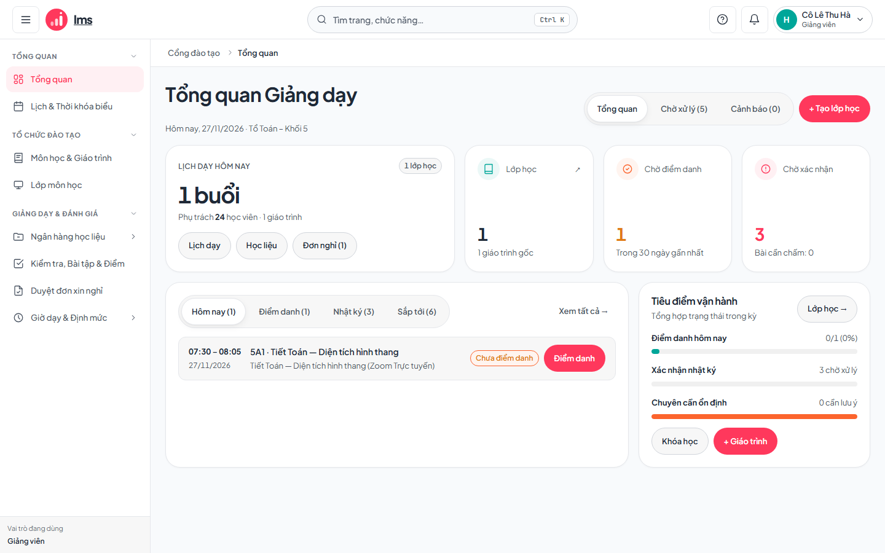
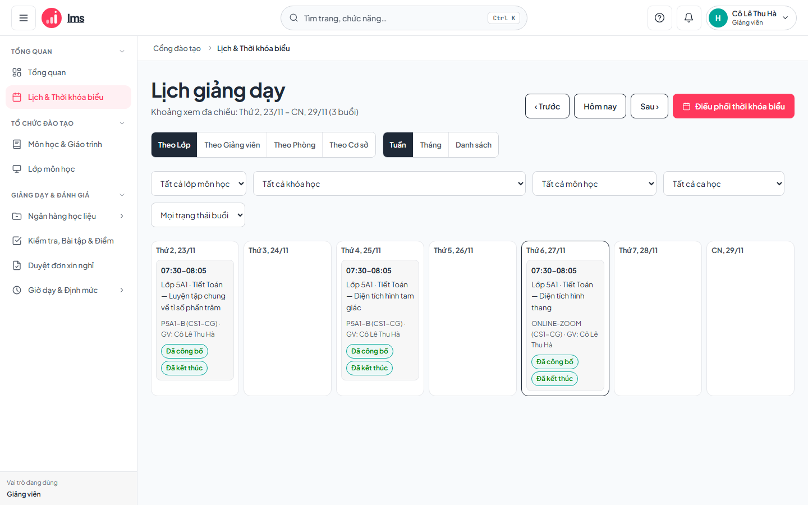
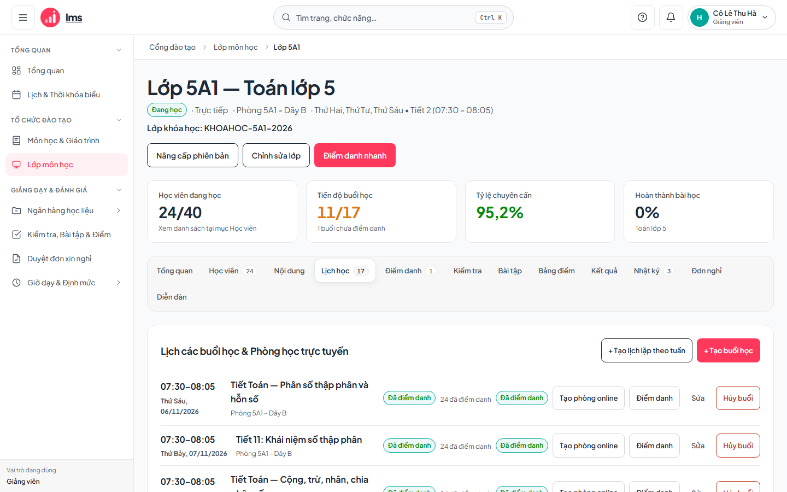
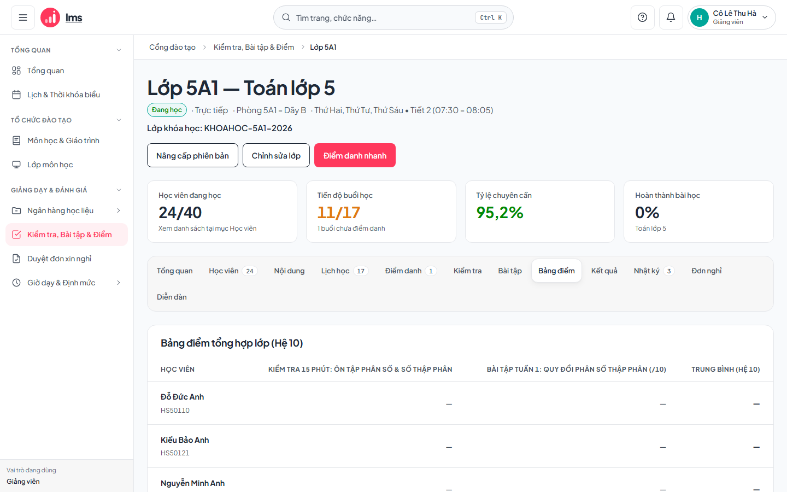
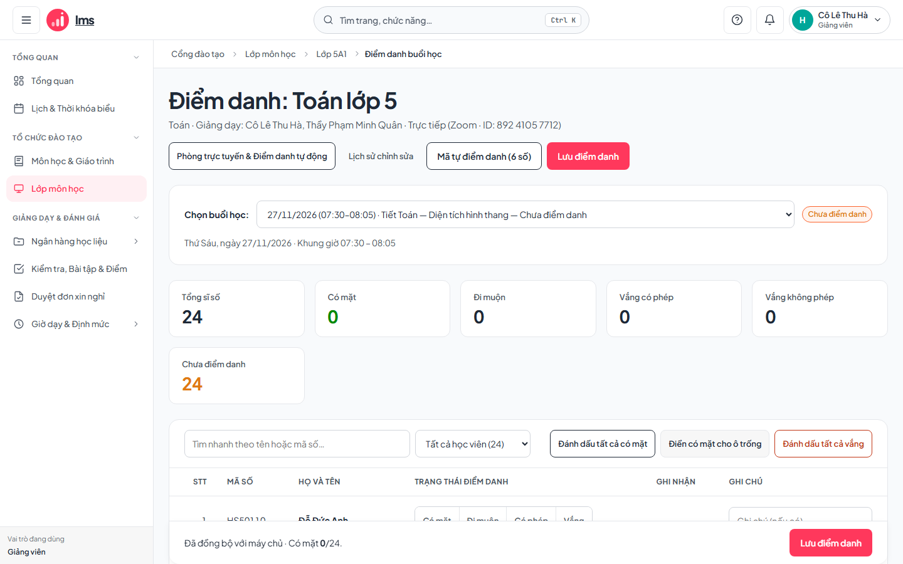
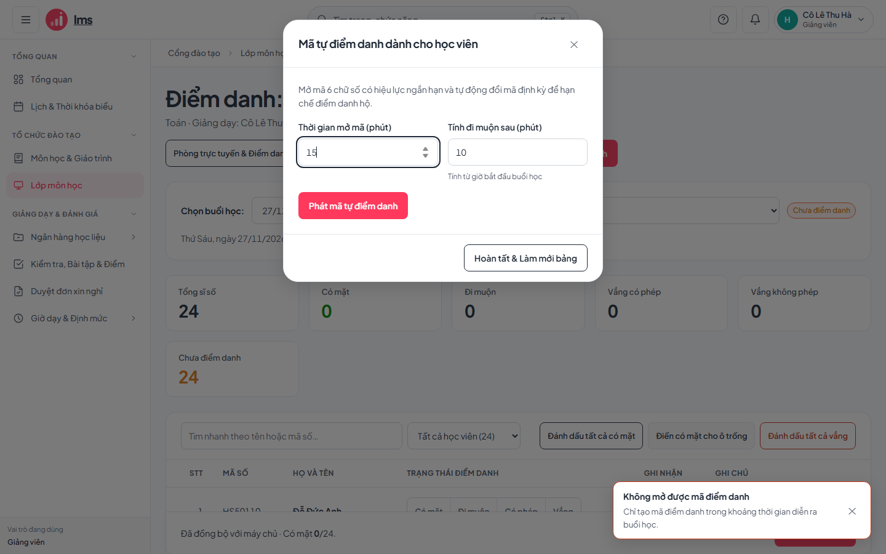
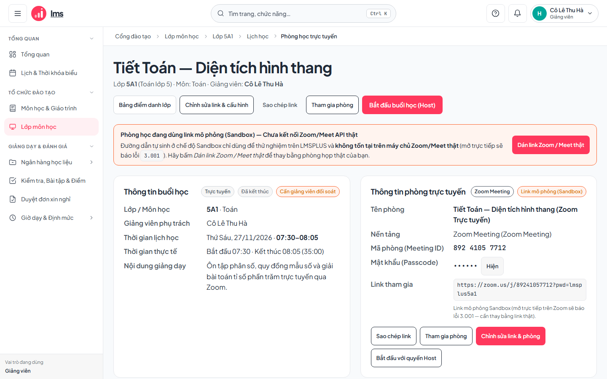
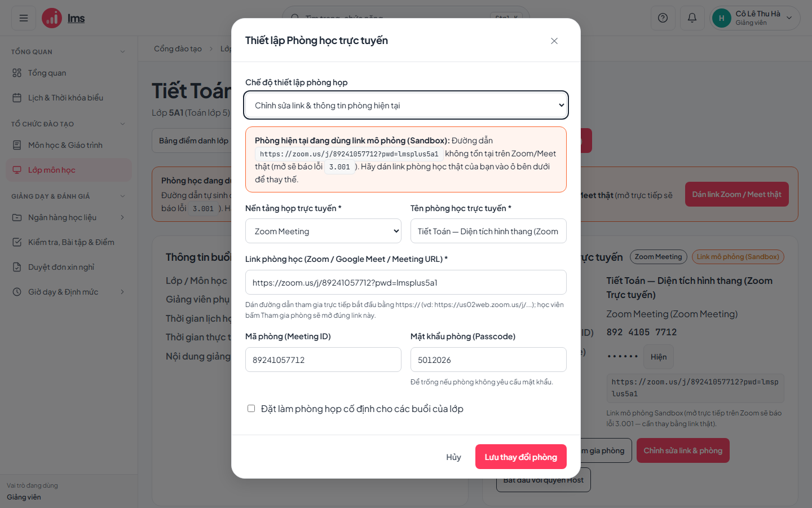

# Chương 04: Tổng quan Giảng dạy, Lớp Môn học, Điểm danh & Phòng Trực tuyến

Đây là nhóm chức năng cốt lõi phục vụ hoạt động giảng dạy hằng ngày của **Giảng viên**, **Trợ giảng** và công tác theo dõi vận hành lớp học của **Giáo vụ / Trưởng bộ môn**.

---

## 1. Tổng quan Giảng dạy (`/teaching`)

- Hiển thị thẻ **Lịch dạy hôm nay**, 3 ô KPI trực quan (*Lớp học*, *Chờ điểm danh*, *Chờ xác nhận nhật ký*), hộp **Tiêu điểm vận hành** và danh sách nhanh theo 4 tab: *Hôm nay*, *Điểm danh*, *Nhật ký*, *Sắp tới*.
- Thanh chuyển chế độ ở góc phải cho phép lọc nhanh: **Tổng quan**, **Chờ xử lý** (gồm buổi cần điểm danh, nhật ký chưa xác nhận, đơn nghỉ chờ duyệt) và **Cảnh báo** (học viên có tỷ lệ chuyên cần thấp).

---

## 2. Lịch & Thời khóa biểu Giảng viên (`/teaching/schedule`)

- Chuyển đổi chế độ **Tuần** / **Tháng**, di chuyển *Tuần trước / Hôm nay / Tuần sau* và lọc theo lớp hoặc hình thức học.
- Mỗi ô lịch thể hiện giờ học, mã lớp, tên buổi học, phòng vật lý hoặc liên kết **Phòng trực tuyến** và lối tắt mở thẳng bảng điểm danh.

---

## 3. Chi tiết Lớp Môn học (`/teaching/classes/:classId`)

Thanh header hiển thị tên lớp, trạng thái, hình thức (*Trực tiếp / Trực tuyến / Kết hợp*), phòng học, liên kết tới Lớp khóa học và **Snapshot giáo trình đang ghim** (vd `v2026.2`). Người có quyền quản lý có thể bấm **Nâng cấp phiên bản** (có ghi log kiểm toán & bảo lưu tiến độ cũ) hoặc **Chỉnh sửa lớp**.

Lớp môn học gồm **12 tab nghiệp vụ**:

| Tab | Chức năng chính |
| --- | --- |
| **Tổng quan** | Thông tin tổ chức lớp, giảng viên/trợ giảng phụ trách, buổi gần nhất và tiến độ trung bình. |
| **Học viên** | Xem sĩ số, trạng thái ghi danh, duyệt yêu cầu tham gia (`REQUEST_APPROVAL`), thêm hoặc Import danh sách học viên hàng loạt. |
| **Nội dung** | Xem bài giảng theo Snapshot đang ghim; bấm mở **Lesson Studio (Chế độ B)** để tùy biến ghi chú riêng cho lớp. |
| **Lịch học** | Xem danh sách tất cả buổi học, bấm **+ Tạo buổi học** / **+ Tạo lịch lặp theo tuần**, **Sửa**, **Hủy buổi** hoặc **Khôi phục** buổi đã hủy. |
| **Điểm danh** | Mở nhanh bảng điểm danh buổi gần nhất hoặc điều hướng tới trang điểm danh chuyên sâu. |
| **Kiểm tra** | Tạo và quản lý đề kiểm tra (lấy câu hỏi từ Ngân hàng hoặc nhập tay), cấu hình thời gian làm bài và số lượt thi. |
| **Bài tập** | Giao bài tập từ ngân hàng hoặc tạo mới kèm Rubric; chấm bài và phản hồi cho từng học viên. |
| **Bảng điểm** | Bảng điểm tổng hợp toàn lớp theo đầu điểm kiểm tra + bài tập + chuyên cần, cho phép xuất CSV và xử lý đơn phúc khảo. |
| **Kết quả** | Thống kê phân bố điểm, tiến độ hoàn thành bài học từng học viên. |
| **Nhật ký** | Xác nhận **Nhật ký giảng dạy** (quy tắc **24 giờ**: quá 24h sau giờ kết thúc chuyển trạng thái `Quá hạn chưa xác nhận` nhưng vẫn cho phép giảng viên xác nhận muộn). |
| **Đơn nghỉ** | Xử lý đơn xin nghỉ của riêng học viên thuộc lớp hiện tại. |
| **Diễn đàn** | Trao đổi, giải đáp thắc mắc và ghim thông báo học tập trong lớp. |

---

## 4. Điểm danh nhanh trên một màn hình (`/teaching/classes/:classId/attendance`)

### Quy trình điểm danh
1. Chọn buổi học ở hộp **Chọn buổi học** trên cùng (mặc định hệ thống tự ưu tiên buổi hôm nay hoặc buổi gần nhất chưa điểm danh).
2. Chọn trạng thái cho từng học viên chỉ với 1 lần nhấp: **Có mặt**, **Đi muộn**, **Có phép**, **Vắng** kèm ô nhập *Ghi chú* bên phải.
3. Sử dụng các nút thao tác hàng loạt trên thanh công cụ: **Đánh dấu tất cả có mặt**, **Điền có mặt cho ô trống**, **Đánh dấu tất cả vắng**, hoặc tìm kiếm theo tên/mã học viên.
4. Thanh trạng thái ghim dưới đáy đếm số thay đổi chưa lưu; bấm **Lưu điểm danh** để ghi nhận kèm lịch sử kiểm toán (*người thực hiện, thời gian, lý do thay đổi*). Nếu rời trang khi chưa lưu, hệ thống hiển thị cảnh báo tránh mất dữ liệu.

### Phát Mã tự điểm danh 6 chữ số luân phiên (QR / OTP động)

1. Bấm nút **Mã tự điểm danh** trên trang Điểm danh.
2. Nhập **Thời gian mở mã (phút)** và ngưỡng **Tính đi muộn sau (phút)** tính từ giờ bắt đầu buổi học.
3. Bấm **Phát mã tự điểm danh** (lưu ý quy tắc bảo mật: hệ thống chỉ cho phép mở mã **trong khoảng thời gian diễn ra buổi học**, ngăn tạo mã cho buổi quá khứ hoặc quá xa).
4. Chiếu mã 6 chữ số (tự động xoay mã định kỳ theo chu kỳ giây cấu hình) lên màn hình lớp để học viên nhập trong mục **Điểm danh 6 số** ở Cổng Học viên.

---

## 5. Phòng học trực tuyến & Điểm danh tự động (`/teaching/.../sessions/:sessionId/live`)

### Nhận diện Phòng thật vs Phòng mô phỏng (Sandbox)
- Nếu hệ thống **chưa cấu hình Zoom / Google Meet Cloud OAuth API thật**, các phòng tạo mẫu hoặc tạo tự động chạy ở chế độ **`Link mô phỏng (Sandbox)`** để kiểm thử luồng điểm danh và Webhook.
- Trên giao diện hiển thị banner cảnh báo rõ ràng (kèm badge **Link mô phỏng (Sandbox)**): mở trực tiếp link mô phỏng này lên máy chủ `zoom.us` sẽ báo lỗi **`3.001` (*Liên kết cuộc họp này không hợp lệ*)**, nên hệ thống tự động chặn không mở tab Zoom ngoài khi bấm *Tham gia phòng* hoặc *Bắt đầu với quyền Host*.
- Để giảng viên & học viên mở được phòng Zoom / Google Meet **thật**, hãy bấm nút **Dán link Zoom / Meet thật** hoặc **Chỉnh sửa link & phòng**.

### Chỉnh sửa & Gắn link Zoom / Google Meet / Teams thật

1. Bấm **Chỉnh sửa link & phòng** (hoặc trong modal **Sửa** của tab *Lịch học*, chọn *Chỉnh sửa link & thông tin phòng hiện tại*).
2. Ở ô **Chế độ thiết lập phòng họp**, hệ thống hỗ trợ 5 chế độ:
   - **Chỉnh sửa link & thông tin phòng hiện tại (`EDIT_CURRENT`):** Sửa trực tiếp link, nền tảng (`Zoom Meeting`, `Google Meet`, `Nền tảng ngoài`), tên phòng, Meeting ID, Passcode mà giữ nguyên phòng hiện có.
   - **Nhập / Gắn link phòng có sẵn (`EXTERNAL_LINK`):** Chế độ mặc định khi tạo phòng mới chưa kết nối API — dán link cuộc họp thật từ Zoom/Google Meet/Teams (`https://...`).
   - **Tạo phòng họp mới tự động qua API (`CREATE_NEW`):** Tự sinh phòng Zoom/Meet (dùng API thật nếu đã cấu hình OAuth, hoặc Sandbox nếu chưa).
   - **Tạo phòng cố định dùng chung cho nhiều buổi (`RECURRING_CLASS`)** và **Sử dụng lại phòng họp đã tạo của lớp (`REUSE_EXISTING`)**.
3. Khi dán hoặc gõ URL Zoom (`https://us05web.zoom.us/j/...`) hay Google Meet (`https://meet.google.com/...`) vào ô **Link phòng học**, hệ thống **tự động trích xuất `Mã phòng (Meeting ID)`** đồng bộ theo link mới.
4. Bấm **Lưu thay đổi phòng**: cảnh báo Sandbox tự biến mất, nút **Tham gia phòng** / **Bắt đầu với quyền Host** mở trực tiếp phòng học thật.

### Theo dõi Trực tiếp, Đối chiếu Danh tính & Chốt Điểm danh
- **4 tab phía dưới trang Phòng học trực tuyến:**
  1. **Theo dõi trực tiếp & Lượt vào/ra:** Liệt kê thời điểm vào/rời phòng, nhận diện `UNKNOWN` (khi học viên vào bằng tên hiển thị không khớp email/token — hệ thống **không tự đoán theo tên** để tránh điểm danh nhầm; giảng viên bấm **Gán học viên** để xác nhận thủ công).
  2. **Bảng điểm danh tự động:** Áp dụng thuật toán gộp khoảng thời gian chồng lấn (*Interval Union* — tránh cộng trùng nếu học viên mở 2 thiết bị hoặc rớt mạng vào lại), lọc thời gian rác `< min_valid_seconds` và phân loại `PRESENT`, `LATE`, `PARTIAL`, `ABSENT`, `EXCUSED`, `MANUAL_REVIEW`. Giảng viên có thể **Điều chỉnh** (bắt buộc nhập lý do lưu audit), **Xuất CSV** hoặc **Chốt điểm danh** sang sổ điểm danh chính thức.
  3. **Quy tắc điểm danh & Kết nối Provider:** Chỉnh *thời gian cho phép vào muộn*, *thời lượng tối thiểu*, *tỷ lệ % tối thiểu* áp dụng cho buổi học hoặc cả lớp; Quản trị viên kiểm tra kết nối Zoom/Meet Adapter tại đây.
  4. **Lịch sử điều chỉnh & Webhook Log:** Theo dõi toàn bộ log điều chỉnh điểm danh và sự kiện Webhook HMAC-SHA256 nhận được từ nền tảng họp.

---

[← Chương 03](./03-lesson-studio-va-hoc-lieu.md) · [Mục lục](./README.md) · [Tiếp theo: Chương 05 — Điều phối Thời khóa biểu, Đơn nghỉ & Giờ dạy →](./05-dieu-phoi-va-van-hanh.md)
