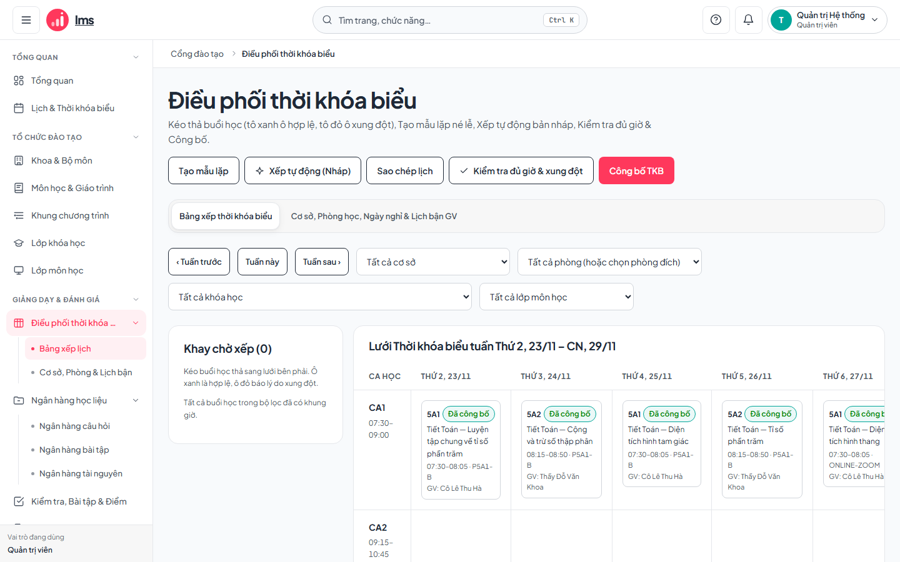
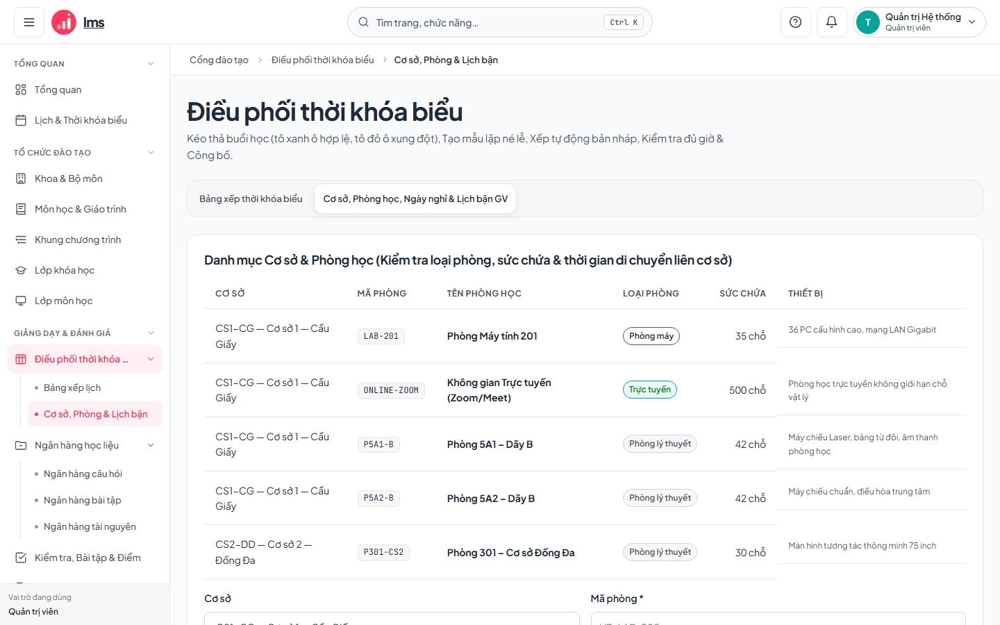
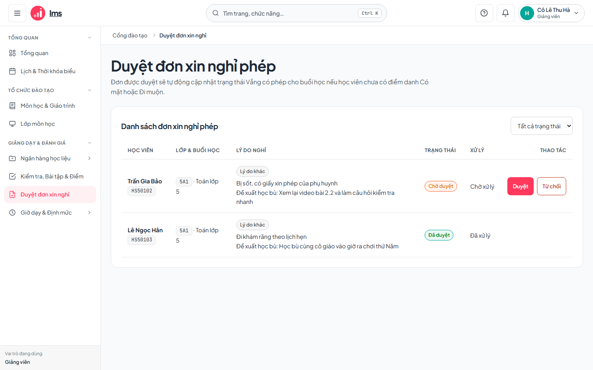
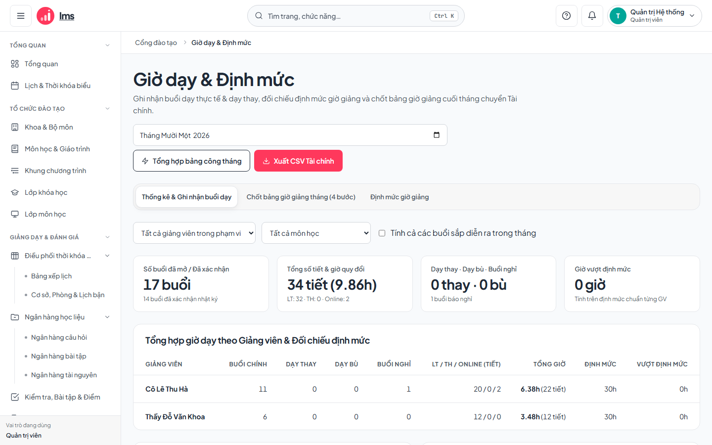

# Chương 05: Điều phối Thời khóa biểu, Duyệt đơn xin nghỉ & Giờ dạy – Định mức

Chương này hướng dẫn các nghiệp vụ điều phối lịch dạy cấp toàn trường/bộ môn, xử lý đơn xin nghỉ phép và tổng hợp bảng công giờ giảng chuyển bộ phận Tài chính.

---

## 1. Điều phối Thời khóa biểu (`/teaching/timetable`)

Chức năng dành cho **Quản trị viên**, **Giáo vụ** và **Trưởng bộ môn**.

### Tab 1: Bảng xếp thời khóa biểu (`?tab=board`)

1. **Lọc không gian xếp lịch:** Chọn *Tuần học*, *Cơ sở*, *Phòng học*, *Khóa học* hoặc *Lớp môn học*.
2. **Xếp lịch bằng Kéo – Thả thông minh:**
   - Kéo một buổi học từ **Khay chờ xếp** bên trái (hoặc điều chỉnh buổi đang nháp trên lưới) đưa vào các ca học (`CA1`..`CA4`) theo ngày trong tuần.
   - Hệ thống kiểm tra 6 ràng buộc cứng theo thời gian thực: **ô hợp lệ hiển thị màu xanh**, **ô xung đột hiển thị màu đỏ kèm lý do chi tiết** (trùng phòng, trùng lịch giảng viên, ngày nghỉ lễ, lịch bận giảng viên...).
3. **Các công cụ xếp lịch nhanh trên thanh công cụ:**
   - **Tạo mẫu lặp:** Sinh lịch định kỳ theo thứ trong tuần, tự động né các ngày nghỉ lễ đã khai báo.
   - **Xếp tự động (Nháp):** Hệ thống tự đề xuất slot hợp lệ cho các buổi đang ở khay chờ.
   - **Sao chép lịch:** Sao chép khung lịch từ tuần trước sang tuần tiếp theo.
   - **Kiểm tra đủ giờ & xung đột:** Chạy báo cáo kiểm toán toàn diện trước khi ban hành.
   - **Công bố TKB:** Chính thức công bố thời khóa biểu cho giảng viên/học viên và đồng bộ mốc hạn nộp bài tập theo lịch buổi học thực tế.

### Tab 2: Cơ sở, Phòng học, Ngày nghỉ & Lịch bận GV (`?tab=facilities`)

- Khai báo danh mục **Cơ sở đào tạo**, **Phòng học** (sức chứa, loại phòng lý thuyết / thực hành / trực tuyến), **Ca học mặc định**, danh sách **Ngày nghỉ lễ** và ghi nhận **Lịch bận cá nhân của Giảng viên** để bộ kiểm tra TKB không xếp đè giờ.

---

## 2. Duyệt đơn xin nghỉ phép (`/teaching/leave-requests`)

### Quy trình xử lý
1. Lọc danh sách đơn theo trạng thái (*Chờ duyệt*, *Đã duyệt*, *Từ chối*, *Đã hủy*). Dữ liệu tự động cô lập theo phạm vi lớp phụ trách của Giảng viên hoặc Bộ môn của Trưởng bộ môn.
2. Kiểm tra lý do nghỉ (nhóm lý do ốm đau, việc riêng, trùng lịch học...), ghi chú đề xuất học bù và liên kết minh chứng (nếu học viên đính kèm).
3. Bấm **Duyệt** hoặc **Từ chối** kèm ghi chú xử lý:
   - Khi bấm **Duyệt**, nếu học viên chưa có điểm danh *Có mặt* hoặc *Đi muộn* cho buổi học đó, hệ thống **tự động đồng bộ trạng thái `Vắng có phép`** vào bảng điểm danh.
   - Nếu giảng viên đã điểm danh học viên *Có mặt / Đi muộn* trước đó, hệ thống bảo toàn nguyên trạng thái thực tế để không ghi đè sai dữ liệu.

---

## 3. Giờ dạy & Định mức (`/teaching/hours`)

Module gồm 3 tab nghiệp vụ rõ ràng (chọn *Kỳ tháng* ở góc phải để theo dõi theo từng tháng):

1. **Tab 1 — Thống kê giờ dạy (`?tab=analytics`):**
   - Theo dõi số buổi đã mở / đã kết thúc, tổng số giờ và tổng số tiết quy đổi (bao gồm cả trường hợp phân công **dạy thay** giữa các giảng viên).
   - Có tùy chọn *Bao gồm cả buổi dự kiến trong tháng* và lọc theo giảng viên / môn học (đối với Giáo vụ / Quản trị viên).
2. **Tab 2 — Chốt bảng giờ giảng (`?tab=timesheets`):**
   - **Giáo vụ / Quản trị:** Bấm tổng hợp bảng giờ giảng toàn kỳ (giữ nguyên các bảng đã khóa sổ), duyệt bảng công và **Khóa sổ tài chính** rồi bấm **Xuất CSV chuyển Tài chính**.
   - **Giảng viên:** Kiểm tra chi tiết từng buổi dạy trong bảng công của mình và bấm **Xác nhận** đúng số giờ hoặc gửi **Khiếu nại / Phản hồi sai sót** kèm ghi chú tới Giáo vụ trước khi khóa sổ.
3. **Tab 3 — Định mức giờ giảng (`?tab=quotas`):** *(Dành cho Quản trị viên & Giáo vụ)*
   - Thiết lập số phút quy đổi 1 tiết (mặc định **45 phút/tiết**), định mức giờ chuẩn theo kỳ/giảng viên và theo dõi cảnh báo vượt định mức hoặc thiếu giờ.

---

[← Chương 04](./04-lop-mon-hoc-va-giang-day.md) · [Mục lục](./README.md) · [Tiếp theo: Chương 06 — Cổng Học viên (Learner Portal) →](./06-cong-hoc-vien.md)
