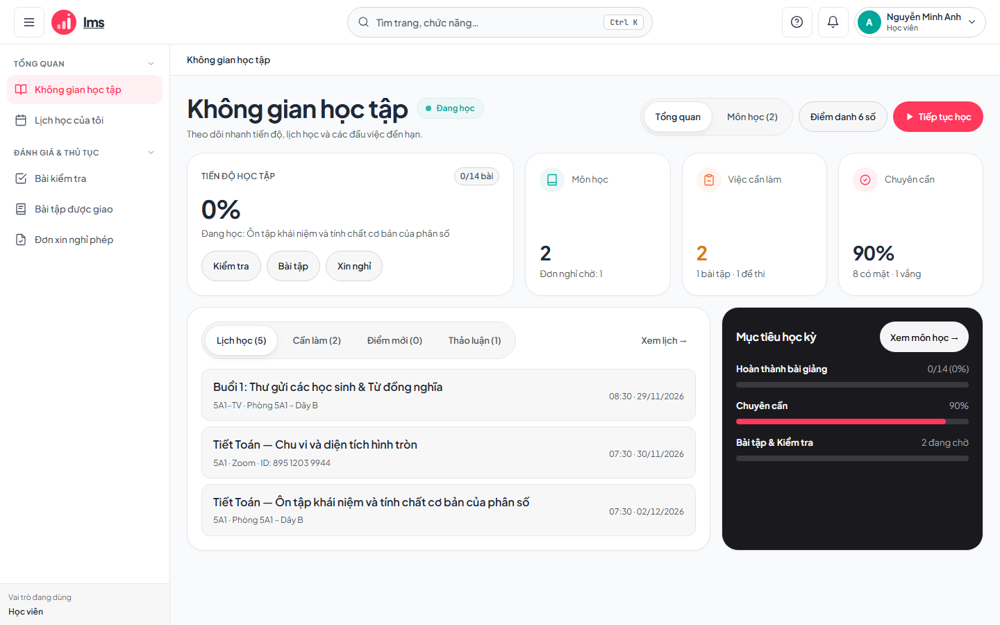
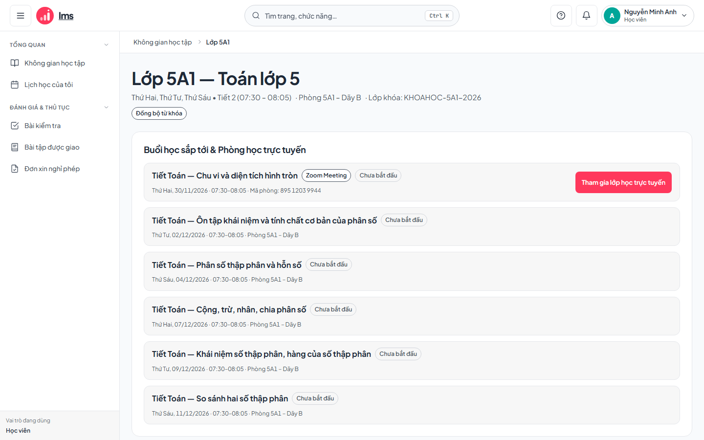
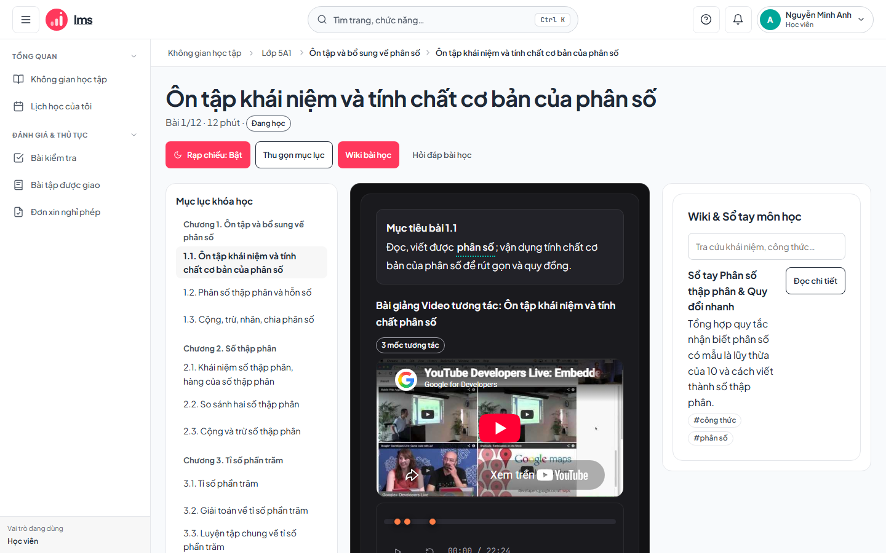
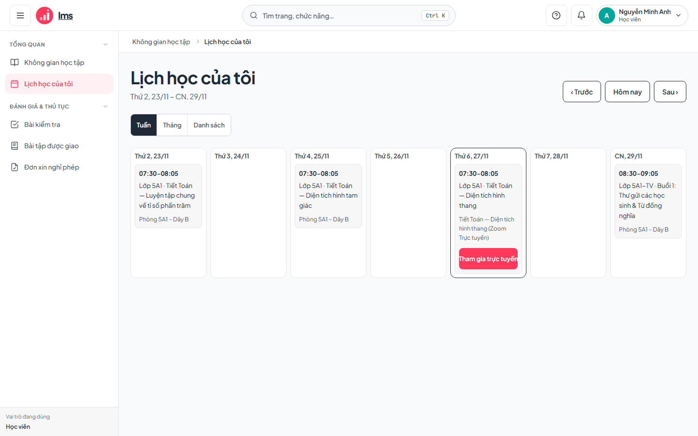
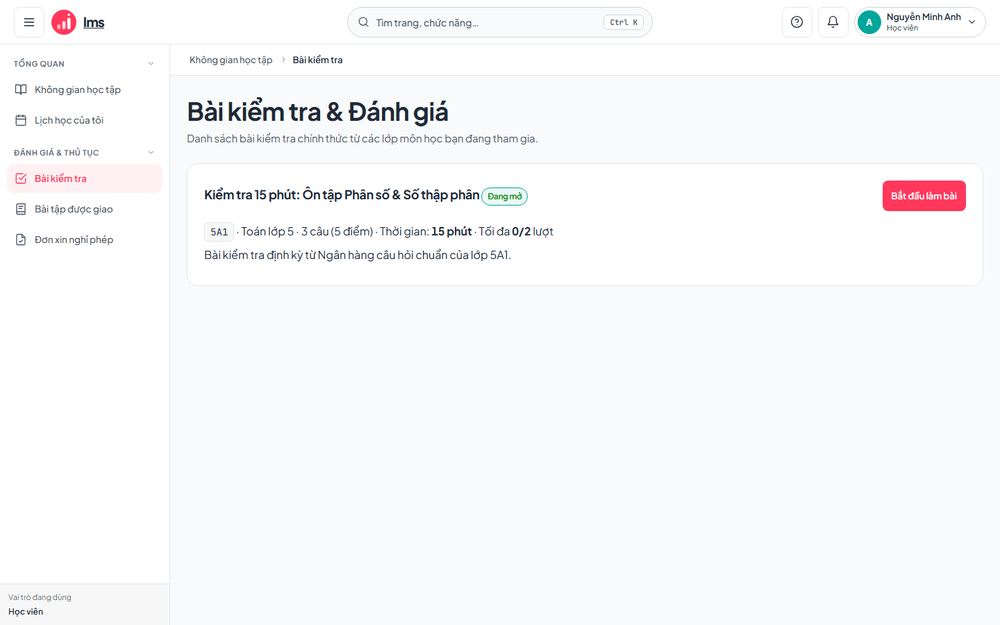
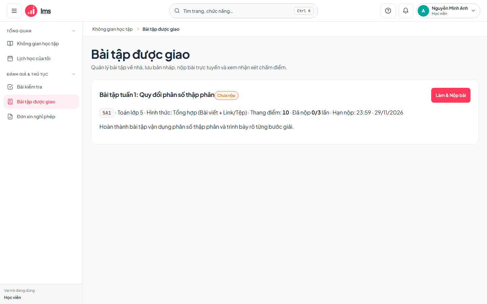
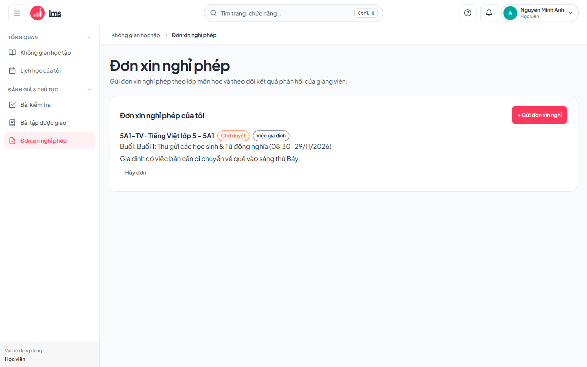

# Chương 06: Cổng Học viên (Learner Portal)

Chương này hướng dẫn toàn bộ trải nghiệm học tập dành cho tài khoản **Học viên** sau khi đăng nhập vào cổng `/learn`.

---

## 1. Không gian học tập (`/learn`)

### Các khu vực chính trên màn hình đầu
- **Thanh điều khiển trên cùng:** Chuyển nhanh giữa **Tổng quan** và danh sách **Môn học**, nút **Điểm danh 6 số**, và nút **▶ Tiếp tục học** đưa thẳng về bài học đang học dở gần nhất.
- **Thẻ Tiến độ & 3 KPI:** Theo dõi % hoàn thành khóa học, số bài đã xong, tổng số việc cần làm (*bài tập* + *đề thi*) và tỷ lệ **Chuyên cần** (*số buổi có mặt / vắng*).
- **Bảng Hoạt động học tập (4 tab):**
  - *Lịch học*: xem giờ học tiếp theo, bấm **Vào lớp online** nếu là buổi trực tuyến (hệ thống tự cấp mã `LMS_JOIN_TOKEN` xác thực danh tính học viên; nếu phòng ở chế độ Sandbox mô phỏng, hệ thống hiển thị hộp thông tin và cảnh báo không mở nhầm Zoom `3.001`).
  - *Cần làm* · *Điểm mới* · *Thảo luận*.
- **Chuyển sang chế độ `Môn học`:** Xem các lớp đang theo học hoặc duyệt/tìm các khóa học mở chế độ **`SELF_ENROLL`** (tự đăng ký học ngay) hoặc **`REQUEST_APPROVAL`** (gửi yêu cầu xin vào lớp).

### Tự điểm danh 6 chữ số
1. Bấm **Điểm danh 6 số** ở góc trên bên phải Không gian học tập.
2. Nhập chính xác **6 chữ số** do giảng viên trình chiếu trên lớp và bấm xác nhận.
3. Hệ thống ghi nhận ngay trạng thái *Có mặt* hoặc *Đi muộn* tùy theo ngưỡng phút giảng viên cấu hình cho phiên mở mã đó.

---

## 2. Chi tiết Lớp học & Học bài giảng Video Strict (`/learn/classes/:classId` & `/lessons/:lessonId`)

Trong trang **Chi tiết Lớp môn học**, học viên sử dụng 8 tab: *Bài học*, *Điểm danh*, *Kiểm tra*, *Bài tập*, *Bảng điểm*, *Đơn nghỉ*, *Wiki môn học* và *Diễn đàn*.

### Trải nghiệm học bài giảng (`StudentLessonPage`)
1. **Cột trái — Mục lục khóa học:** Theo dõi các chương, bài học đang học và bài đã hoàn thành; có thể thu gọn mục lục để tập trung tối đa.
2. **Vùng giữa — Nội dung & Trình phát Video tương tác:**
   - Hỗ trợ bật/tắt **Rạp chiếu (Cinema Focus)** làm nổi bật khung bài giảng.
   - Khi bài học gắn **Video Strict / Video Quiz**: học viên cần xem đạt tỷ lệ thời lượng tối thiểu và trả lời các câu hỏi tại **các mốc tương tác** hiện trên thanh tiến trình (các chấm cam) trước khi bấm hoàn thành bài học; nếu chưa đạt điều kiện, hệ thống sẽ báo rõ tiêu chí còn thiếu.
3. **Cột phải — Wiki & Hỏi đáp bài học:** Tra cứu nhanh thuật ngữ/công thức gắn thẻ `#từ_khóa` ngay bên cạnh bài giảng hoặc chuyển sang tab thảo luận bài học.

---

## 3. Lịch học của tôi (`/learn/schedule`)

- Xem lịch học theo **Tuần** hoặc **Tháng**, lọc theo buổi *Trực tiếp / Trực tuyến* và bấm tham gia phòng học trực tuyến ngay từ lịch học.

---

## 4. Bài kiểm tra & Phúc khảo (`/learn/exams`)

1. Xem danh sách đề kiểm tra đang mở kèm thông tin lớp, số câu, tổng điểm, thời lượng giới hạn và số lượt đã thi.
2. Bấm **Bắt đầu làm bài** (hoặc **Tiếp tục làm bài** nếu còn lượt đang làm dở):
   - Bộ đếm ngược thời gian hiển thị liên tục ở đầu phiên làm bài.
   - Đáp án được **lưu nháp tự động** định kỳ để tránh mất bài khi rớt mạng.
3. Bấm **Nộp bài**: hệ thống chấm tức thì phần trắc nghiệm và hiển thị điểm chi tiết từng câu + nhận xét giảng viên (sau khi chấm tự luận).
4. Nếu có thắc mắc về điểm số, bấm **Gửi phúc khảo**, nhập lý do và điểm đề nghị xem xét để gửi tới Trưởng bộ môn / Giảng viên xử lý.

---

## 5. Bài tập được giao (`/learn/assignments`)

1. Mở bài tập để xem mô tả, hạn nộp, điểm tối đa và **bảng tiêu chí Rubric** chi tiết.
2. Tùy theo cấu hình bài tập, nộp bài bằng:
   - Soạn thảo văn bản trực tiếp,
   - Dán liên kết sản phẩm (`https://...`), hoặc
   - Tải lên tệp bài làm (PDF, tài liệu theo định dạng cho phép).
3. Sau khi giảng viên chấm theo từng tiêu chí Rubric, xem điểm từng tiêu chí và có thể gửi **Phúc khảo** ngay tại bài tập đó.

---

## 6. Đơn xin nghỉ phép (`/learn/leave-requests`)

1. Bấm **+ Gửi đơn xin nghỉ phép**.
2. Chọn **Lớp học**, chọn **Buổi học cụ thể** (hoặc nghỉ không gắn một buổi cố định), chọn **Nhóm lý do** (*Ốm đau*, *Việc gia đình*, *Trùng lịch học thuật*...), nhập *Lý do chi tiết*, *Đề xuất học bù* và *Link minh chứng* (nếu có).
3. Theo dõi trạng thái *Chờ duyệt*, *Đã duyệt* (tự đồng bộ *Vắng có phép* vào bảng chuyên cần) hoặc *Từ chối*; có thể bấm **Hủy đơn** khi đơn vẫn đang ở trạng thái *Chờ duyệt*.

---

[← Chương 05](./05-dieu-phoi-va-van-hanh.md) · [Quay lại Mục lục](./README.md)
